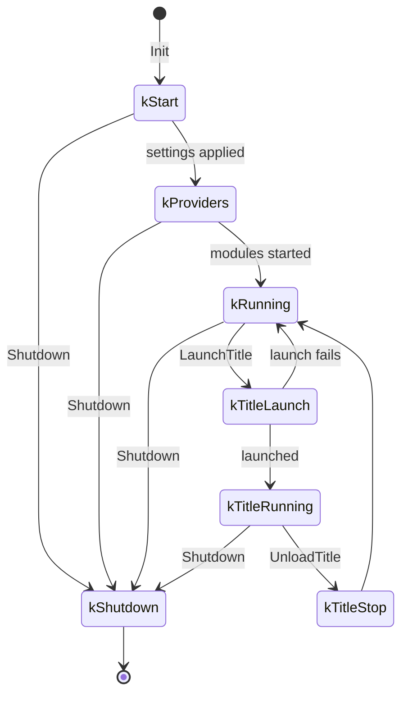
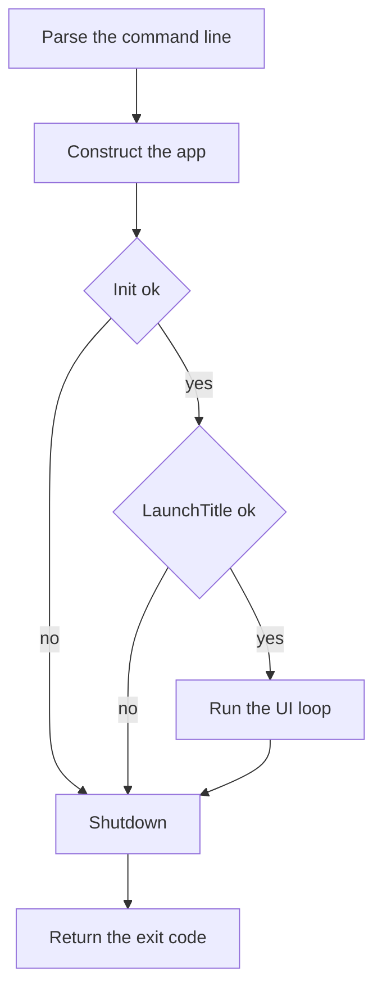
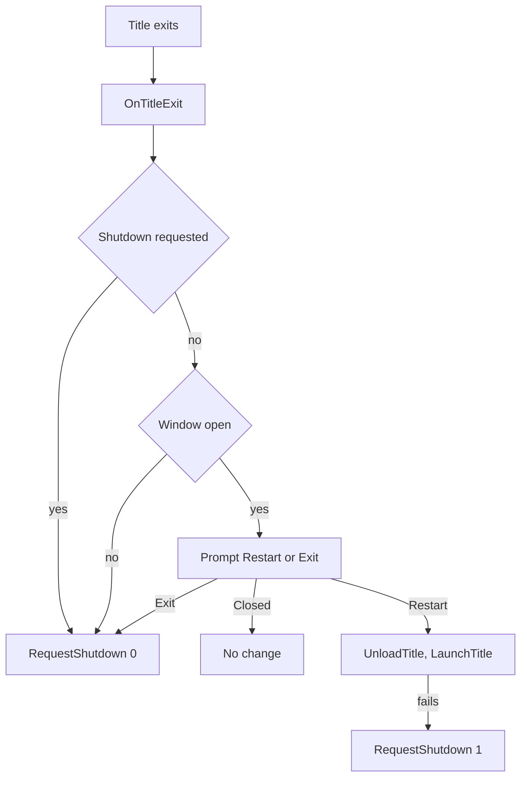

# App Lifecycle

Every ReXGlue program is a class derived from `rex::app::App`, or from `rex::app::TitleApp` when it runs a game. The app object starts and stops the SDK. This page lists the steps the app runs, the hooks it calls during them, and the order in which a program starts, runs a title and stops.

## Steps and Hooks

A step is a public method of the app that the program calls. A hook is a virtual method that a step calls at a fixed point, and that your class overrides to add its own work. Every hook does nothing or returns success by default.

`App` has four steps:

- `Init` loads the modules, applies the settings and starts the systems.
- `RunFrame` runs one frame of the UI loop.
- `Run` calls the `OnRun` hook, which by default calls `RunFrame` until a shutdown is requested.
- `Shutdown` stops everything that `Init` started and returns the exit code. It is safe to call after a failed `Init`.

`TitleApp` adds two steps for the game:

- `LaunchTitle` loads the title, calls `OnTitleLaunch` and starts it.
- `UnloadTitle` stops the title and frees its memory. A program can launch and unload the title any number of times.

See `App` and `TitleApp` in the API reference for the purpose of each hook.

### UI Thread

The UI thread is the thread that calls `App::Init`. It runs the window and its event loop. In a `TitleApp`, every step and every hook runs on the UI thread.

- To run code on the UI thread from another thread, call `IUISystem::PostTask`.
- `IUISystem::HasWindow` returns false when the program runs headless, with no window.

### Phases

`App::GetPhase` returns the `AppPhase`, the part of the lifecycle that is running. Only a `TitleApp` enters the three title phases.



## Entry Macros

An entry macro defines `main`, and `wWinMain` on Windows. It parses the command line, constructs the app with its default constructor and calls the steps.

| Macro | Runs |
|---|---|
| `REX_CONSOLE_APP` | `Init`, then `Run` if it succeeded, then `Shutdown`. |
| `REX_TITLE_APP` | `Init` and `LaunchTitle` while each succeeds, then `Run`, then `Shutdown`. |
| `REX_CONSOLE_APP_MAIN`, `REX_TITLE_APP_MAIN` | Your function, which receives the app and the command line and returns the exit code. |

To run work between steps, such as an installer before the launch, use a `_MAIN` macro:

```cpp
int GameMain(Game& game, const rex::CLIArgList& args) {
  if (game.Init(args)) {
    while (game.NeedsInstall() && game.RunFrame()) {
    }
    if (game.LaunchTitle()) {
      game.Run();
    }
  }
  return game.Shutdown();
}
REX_TITLE_APP_MAIN(Game, GameMain)
```

If an exception escapes, the entry macro prints it to standard error and returns 1.

## Startup Order

`REX_TITLE_APP` runs the steps in this order and goes to `Shutdown` at the first step that fails:



See [Exit Code](#exit-code) for the value that `main` returns.

### Init

`App::Init` runs these steps on the UI thread:

1. The app installs the signal handlers and registers its own settings `app.name`, `app.root`, `app.log_root` and `app.single_instance`.
2. `OnModules` runs, so the program can change the list of module libraries, and `OnRegisterModules` runs, so it can add code modules.
3. `rex::Init` loads and connects the modules. Each module registers its settings and log categories.
4. The app sets `app.name` and `app.root` at the title layer, then calls `OnConfigure`.
5. The app calls `GetActions` and reads the command line.
6. `OnAction` runs once for each action given on the command line.
7. If `app.single_instance` is not empty, the app takes the instance lock of that name.
8. If the config file exists, the app loads it.
9. The app applies the `REX_` environment variables.
10. The app opens the log file.
11. The app installs the crash reporter with the options from `GetCrashOptions`.
12. The app calls `GetRequirements` and collects the driver modules that the driver settings select.
13. `rex::Init` loads the driver modules, starts the profiler if `perf.profiler` is set, and inits every module. Each system starts its drivers. On Windows, `rex::Init` raises the timer resolution to 1 ms.
14. The app freezes the `kStartupOnly` settings.
15. `OnInit` runs. The systems run and the window is open.
16. The app reports each setting name from a source that no settings class declares.

A shutdown or restart requested in `OnConfigure` or in `OnAction` ends `Init` after step 6. No driver module loads, `OnInit` does not run, `Init` returns Ok and logs no error, and the program goes on to `Shutdown`, which starts the new process when a restart was requested. A caller that calls `Init` itself tells this from a finished start with `rex::app::IsShutdownRequested`. A request made in `OnInit` or later does not change the start.

Steps 4 to 12 run inside the `select_plugins` callback of `rex::Init`, after the modules connect and before they init. See [Modules and Interfaces](modules.md#lifecycle) for that callback.

The system getters such as `GetUI` work from `OnConfigure` on. A value that `OnConfigure` sets goes to the title layer, so the config file, the environment and the command line override it. See [Sources and Precedence](settings.md#sources-and-precedence).

#### Failures

A failed step calls `ReportError`, which logs the error, and `App::Init` returns the error. `TitleApp` shows the error in a message box unless the program runs headless.

| Step | Fails when |
|---|---|
| 3, 13 | A module fails to load, connect or init. A driver module that fails to load only logs a warning, but a system that needs it then fails to init. |
| 4, 6, 15 | `OnConfigure`, `OnAction` or `OnInit` returns an error. |
| 5 | An option is not a setting name, an action or one of the [older options](settings.md#command-line), or a setting rejects its value. `GetActions` returns an action with an invalid name, a duplicate name or the name of an older option. |
| 7 | Another running copy holds the instance lock. |
| 8 | The config file does not parse. A missing file is not an error. Clearing `app.config_file` in `OnConfigure` skips the step. |
| 13 | A system that the app requires has no driver. A `TitleApp` fails when `gpu.driver`, `apu.driver`, `ui.driver` or `hid.drivers` is `none`. |
| 16 | No settings class declares a setting name from the command line. A name from the config file or the environment only logs a warning. |

See [Selecting Drivers](modules.md#selecting-drivers) for the driver settings.

### LaunchTitle

`TitleApp::LaunchTitle` returns success without loading anything when a shutdown was requested. It fails when `title.game_root` is empty or is not a folder. Otherwise it runs these steps:

1. The app calls `TitleRuntime::Load`.
2. The app registers the exit callback, which posts `TitleApp::OnTitleExit` to the UI thread.
3. The app calls `OnTitleLaunch`. If the hook returns an error, the title unloads and the launch fails.
4. The app calls `TitleRuntime::Launch`.

From step 4 until the title unloads, a write to a `kUntilLaunch` setting such as `title.game_root` fails. See [Runtime Lifecycle](../runtime/lifecycle.md) for what `Load` and `Launch` do.

## Title Exit

A title can end on its own. The runtime then reports one of these `kernel::TitleExitReason` values:

| Reason | Cause |
|---|---|
| `kNormalExit` | The main thread of the title returns. The other guest threads run until the title unloads. |
| `kHardExit` | The title calls `HalReturnToFirmware`. |
| `kTitleDataError` | XAM reports that title data could not be read from the disc. |
| `kBugCheck` | The title calls `KeBugCheck` or `KeBugCheckEx`. |

The last three stop every guest thread at once. In every case `TitleApp::OnTitleExit` runs on the UI thread. It does not run when the program unloads the title with `UnloadTitle` or `Shutdown`.

The default `OnTitleExit` requests a shutdown with exit code 0 when a shutdown was requested before or no window is open. Otherwise it asks the player to restart the title or exit. If the player closes the prompt, nothing changes. If the restart fails to launch the title, the app requests a shutdown with exit code 1.



To return to your own launcher instead, override `OnTitleExit`.

## Shutdown

A shutdown starts with a request, and the program then calls `App::Shutdown`, which the entry macros do after `Run` returns.

- `rex::app::RequestShutdown` requests a shutdown with an exit code. It works from any thread.
- `rex::app::RequestRestart` requests a shutdown with code 0, then starts the process again with the given arguments or the original ones. Under gamescope on Linux the process does not start again.
- Closing the window requests a shutdown with exit code 0.
- Ctrl+C, Ctrl+Break and closing the console window on Windows, and SIGINT and SIGTERM on Linux and macOS, request a shutdown with exit code 0.

### Teardown Order

`App::Shutdown` runs these steps:

1. `OnStop` runs. `TitleApp::OnStop` ends the frame loop, cancels open prompts and calls `TitleRuntime::Unload`.
2. The unload waits for every guest thread to stop. See [Stopping a Thread](../runtime/kernel.md#stopping-a-thread).
3. If `OnInit` finished, `OnShutdown` runs. Logging and settings work here.
4. `OnRelease` runs. `TitleApp::OnRelease` shuts down COM on Windows.
5. The app removes its settings, releases the instance lock and calls `rex::Stop`, which shuts down and disconnects the modules.
6. If a restart was requested, the app starts the new process.
7. The app flushes the log and removes the signal handlers.

The `App` destructor then calls `rex::Shutdown`, which unloads the module libraries and ends the settings and logger sessions.

### Exit Code

The exit code is the code of the first `RequestShutdown`. Later requests do not change it. Without a request, the code is 1 if a step failed and 0 otherwise.

## Lifetimes

| Object | Valid until |
|---|---|
| A context or factory passed to `Initialize` or `Connect` | The matching `Shutdown` or `Disconnect` returns. |
| Guest memory of the title | `TitleRuntime::Unload` |
| The process logger from `REX_LOGGER()` | The process ends. |
