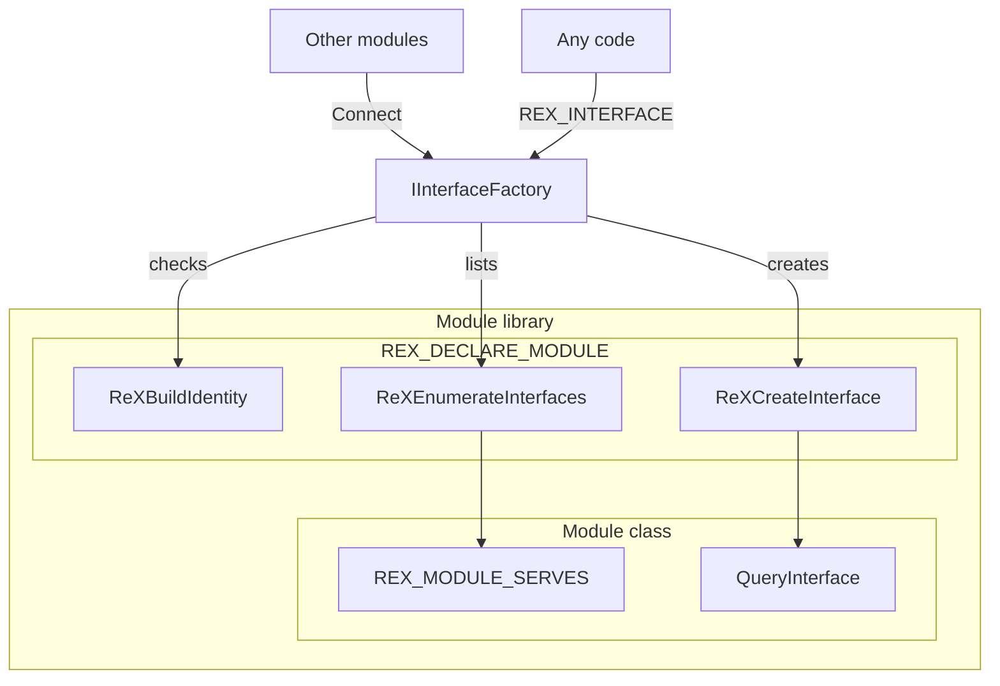
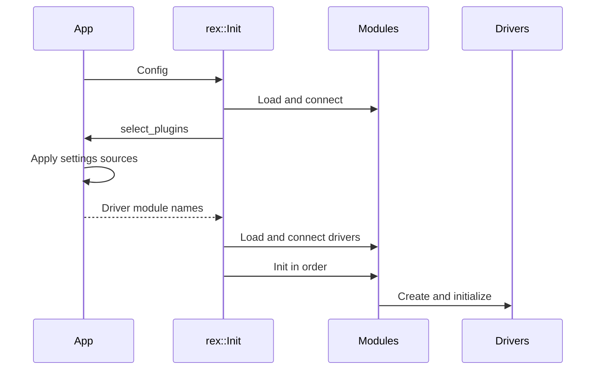
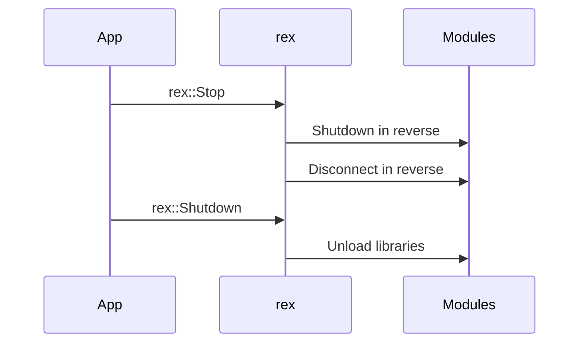
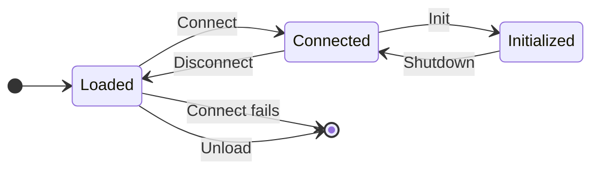

# Modules and Interfaces

The SDK is built from modules that find each other at runtime. This page explains what a module is, how modules reach each other through interfaces, and how the app starts and stops them.

## What a Module Is

A module is an object that implements `rex::IModule` from `rex/module.h`. It has a name and four lifecycle calls, `Connect`, `Init`, `Shutdown` and `Disconnect`, that the app calls in a fixed order. Most modules live in a shared library that the app loads by name at runtime. The program never links these libraries, so a library can be replaced or left out without a rebuild.

There are three kinds of module:

- A system module is one of the seven SDK libraries that an `App` loads at every start. Five of them provide the filesystem and the four systems for input, audio, UI and graphics. The other two, `rexxam` and `rexkernel`, connect the XAM and kernel parts of the SDK.
- A driver module is a shared library that provides drivers. A driver is the host implementation that a system runs, such as SDL3 audio or Vulkan graphics. The app loads a driver module only when a setting selects one of its drivers.
- A code module is a module compiled into your program. The app adds it to the list without loading a library.

A module library contains one `REX_DECLARE_MODULE` line. The macro creates the module object and exports three functions from the library: `ReXBuildIdentity`, `ReXEnumerateInterfaces` and `ReXCreateInterface`. The app reads the build identity first and refuses a library from another SDK build. It then lists the interfaces the module serves and creates the module object through `ReXCreateInterface`.

## Interfaces

Modules never call each other's classes. Each module serves interfaces, and other code asks for an interface by its name and version. An interface is an abstract class with only pure virtual calls, so a module can change its implementation without breaking its callers.

### Declaring an Interface

`REX_DECLARE_INTERFACE(Name, version)` from `rex/module.h` opens a class that derives from `IInterface` and declares `kInterface`, the name and version that a lookup matches. The macro writes the `public:` label.

```cpp
namespace rex::example {
REX_DECLARE_INTERFACE(IExample, 1)
  virtual Result<void> Run() = 0;
};
}  // namespace rex::example
```

The name is the qualified type name, such as `rex::kernel::IObjectTable`, so the class must be in a named namespace. The version is the version of the class layout. A lookup matches both exactly, so a caller built against version 1 never receives a version 2 object.

`REX_DECLARE_PRIVATE_INTERFACE(Name, version)` declares an interface that only the app and the kernel can find. The SDK uses private interfaces for calls that title code must not make, such as running the frame loop of the UI.

### Finding an Interface

Any code can call `REX_INTERFACE(T)` from `rex/module.h` to get an interface that a module serves, such as `REX_INTERFACE(IAudioSystem)`. It returns null in these cases:

- No module serves the interface.
- The app has not connected the modules yet. This includes `App::OnConfigure`, where the `App` getters such as `GetAudio` work instead.
- `rex::Stop` has run.

The filesystem, the content manager and the achievement manager belong to the loaded title, not to a module, so `REX_INTERFACE` does not return them. Get them from the `TitleRuntime`, through `REX_RUNTIME()` or the runtime your code receives, such as `REX_RUNTIME()->GetFileSystem()`. See [Runtime Lifecycle](../runtime/lifecycle.md) for when the runtime exists.

### Interfaces a Module Serves

A module lists the interfaces it serves, other than `IModule`, with `REX_MODULE_SERVES`, and returns them from `QueryInterface`. The three exported functions read these two members:



`IInterfaceFactory` is the lookup that the app builds over every loaded module. A module receives it in `Connect`, and `REX_INTERFACE` uses the same lookup. Ahead of the modules, it serves three interfaces of the SDK itself: the settings registry (`ISettingsRegistry`), the logger (`ILogger`) and `IDriverContext`.

### Driver Interfaces

A driver module also serves `IDriverModule`. Its `GetDrivers` call returns one `DriverRegistration` for each driver in the library:

| Field | Purpose |
|---|---|
| `type` | The driver type: `kGraphics`, `kAudio`, `kInput` or `kUI`. |
| `name` | The name that a setting selects the driver by, such as `sdl3`. |
| `family` | `kXenos` for a Xenos graphics driver, `kNone` for the other types. |
| `create` | The function that creates the driver. It runs only for a selected driver. |

A driver implements `IDriver`. The system of its type calls `IDriver::Initialize` with an `IDriverContext`, which is the only way a driver reaches the rest of the SDK:

- `GetSettingsRegistry` and `GetLogger` return the settings registry and the logger, where the driver adds its own settings and log categories.
- `RunOnUIThread` runs a function on the UI thread and waits for it.
- `PostToUIThread` queues a function for the UI thread and returns at once.

A graphics driver also receives its window surface through `IGraphicsDriver::SetSurface` and the running title through `AttachTitle`. See [Driver Context](../devices/driver-context.md) for what it receives at attach. The other driver types never see the title.

## Lifecycle

`App::Init` fills a `rex::Config` from `rex/init.h` and calls `rex::Init`. A program with no `App` can fill the config and call `rex::Init` itself.

| `Config` field | Purpose |
|---|---|
| `modules` | The module libraries to load, in order. |
| `code_modules` | The code modules. They come before the libraries in the list. |
| `select_plugins` | A callback that returns more libraries to load once the list has connected. An `App` returns the driver modules of the selected drivers. |

Each module goes through two steps on the way up. `Connect` only looks up the interfaces the module needs. `Init` starts the module, and may start threads and drivers. `rex::Init` connects every module before it inits any:



1. `rex::Init` adds the code modules, loads the listed libraries and connects every module in list order.
2. `select_plugins` runs. In an `App`, the command line, the config file and the environment apply in this callback, so the driver settings hold their final values. The callback then returns the driver modules that those settings name.
3. `rex::Init` loads the driver modules, and each one connects as it loads.
4. `rex::Init` calls `Init` on every module in list order. Each system selects and initializes its drivers in its own `Init`.

During `Connect`, a module finds only the interfaces of the SDK and of the modules before it in the list. A module can list the interfaces it cannot connect without in `IModule::GetRequiredInterfaces`. When one of them is served only by a later module, the module fails to connect with an error that names the module, the interface and its version. From `Init` on, a module finds the interface of every connected module, so a module that needs an interface of a later module looks it up in `Init`.

A driver module that fails to load does not stop `rex::Init`, which logs a warning and continues. A system that needed one of its drivers then fails in `Init`, and the error carries the load warning.

The app stops the modules in two calls:



- `rex::Stop` shuts down and then disconnects every module in reverse list order. After it, `REX_INTERFACE` returns null.
- `rex::Shutdown` unloads the libraries and ends the settings and logger sessions.
- `App::Shutdown` calls `rex::Stop`, and the `App` destructor calls `rex::Shutdown`.

A module therefore moves between these states:



## System Libraries

An `App` loads these libraries, in this order:

1. `rexfilesystem`
2. `rexhid`
3. `rexapu`
4. `rexui`
5. `rexgpu`
6. `rexxam`
7. `rexkernel`

See [Binaries and Modules](../appendix/binaries-and-modules.md#system-libraries) for the interfaces each one serves and requires. To change the list, override `App::OnModules`.

- `rexkernel` must come last. It reads the filesystem, input, audio, UI, graphics and XAM interfaces during `Connect`, and those come only from earlier modules.
- `rexxam` must come before `rexkernel`. A program that never launches a title can remove it. Without it, `TitleRuntime::Load` fails with "the rexxam module is not loaded, a title cannot launch without it".
- `rexhid` can be removed when the app needs no input.

## Selecting Drivers

Each system has a setting that names its drivers. The app turns the names into driver modules before `Init`, and each system creates its drivers during `Init`.

- `GetDriverModules` from `rex/driver_module.h` returns the library names of the drivers that the settings name, and skips drivers that a connected module provides.
- `SelectDrivers` creates and initializes the drivers of one type in list order.
- A setting can hold several names separated by commas. Empty names, repeats and `none` are skipped.
- When a driver fails, `SelectDrivers` shuts down the drivers that the same call started before it.
- The input system runs every driver in its list. The audio, UI and graphics systems use the first one.

| Driver type | Setting | Default | On failure |
|---|---|---|---|
| Graphics | `gpu.driver` | `any`, which is `d3d12` on Windows and `vulkan` elsewhere | `App::Init` fails. |
| Audio | `apu.driver` | `sdl3` | The audio system logs a warning and runs with no driver. `App::Init` fails when the app requires audio. |
| Input | `hid.drivers` | `sdl3` | The input system tries each name on its own and logs a warning for each one that fails. `App::Init` fails with "no input driver started, and the app needs input" when none started and the app requires input. |
| UI | `ui.driver` | `sdl3` | The UI system logs a warning. `App::Init` fails when the app requires a UI. |

### Requirements

`App::GetRequirements` returns a `rex::AppSysRequirements`, which says which systems the program needs:

| Field | Purpose |
|---|---|
| `graphics_family` | `kXenos` requires a Xenos graphics driver. `kNone` starts no graphics driver at all. |
| `audio` | Requires an audio driver. |
| `input` | Requires at least one input driver. |
| `ui` | Requires a UI driver with a display and an open window. |

`App` requires nothing. `TitleApp` requires the Xenos family, audio, input and the UI.

### Module Names

The app finds a driver module from the name of the driver. The module name is the name of the system library, a hyphen and the driver name, such as `rexapu-sdl3` for the `sdl3` audio driver and `rexhid-xinput` for the `xinput` input driver. A graphics driver module adds its family before the driver name, such as `rexgpu-xenos-vulkan`. A graphics driver with no family can only come from a code module. See [Binaries and Modules](../appendix/binaries-and-modules.md#driver-modules) for every driver module the SDK builds.

## Where Modules Load From

`rex::Init` loads each module library from the folder of the executable, on every platform.

- `rexglue_configure_target` copies the system libraries and every built driver module there. `EXCLUDE` leaves out the modules it names, and `NO_COPY` copies nothing.
- An installed SDK puts its module libraries in `bin` next to `rexglue`.

The file name adds a postfix for the build configuration: `d` for Debug, `rd` for RelWithDebInfo and nothing for Release. A Debug build loads `rexapu-sdl3` from these files:

| Platform | File |
|---|---|
| Windows | `rexapu-sdl3d.dll` |
| Linux | `librexapu-sdl3d.so` |
| macOS | `librexapu-sdl3d.dylib` |

- A missing file fails `rex::Init` with "module 'rexapu-sdl3' not found at" and the path it tried.
- Every module must come from the same SDK build as the program. A module from another build fails with "was built for another release".

## Write a Module

1. Derive a class with a default constructor from `IModule`, and also from `IDriverModule` if it provides drivers.
2. List the interfaces it serves, other than `IModule`, with `REX_MODULE_SERVES`.
3. Override `QueryInterface` to return them through `FindModuleInterface`.
4. Add `REX_DECLARE_MODULE(ModuleClass)` once in the library.

```cpp
std::unique_ptr<rex::IDriver> CreateDriver();

constexpr std::array<rex::DriverRegistration, 1> kDrivers = {
    rex::DriverRegistration{rex::DriverType::kAudio, "mine", {}, &CreateDriver}};

class MyModule final : public rex::IModule, public rex::IDriverModule {
 public:
  REX_MODULE_SERVES(rex::IDriverModule)

  std::string_view GetName() const override { return "rexapu-mine"; }
  rex::Result<void> Connect(rex::IInterfaceFactory& factory) override { return rex::Ok(); }
  void Disconnect() override {}
  rex::Result<void> Init() override { return rex::Ok(); }
  void Shutdown() override {}
  rex::IInterface* QueryInterface(std::string_view name, rex::u32 version) override {
    return rex::FindModuleInterface<rex::IDriverModule>(*this, name, version);
  }
  std::span<const rex::DriverRegistration> GetDrivers() const override { return kDrivers; }
};

REX_DECLARE_MODULE(MyModule)
```

To add a code module, add it in `App::OnRegisterModules`. Code modules connect before the libraries, and the app never loads or unloads them.

```cpp
void MyApp::OnRegisterModules(std::vector<rex::IModule*>& modules) {
  modules.push_back(&my_module_);
}
```

A module whose `Connect` fails never receives `Disconnect`, so `Connect` must release what it acquired before it returns the error.
