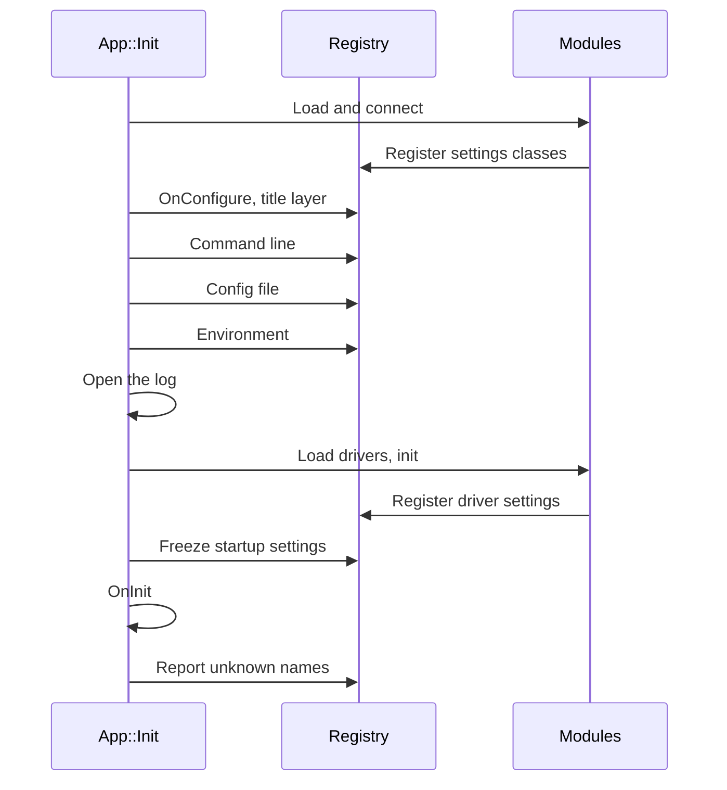
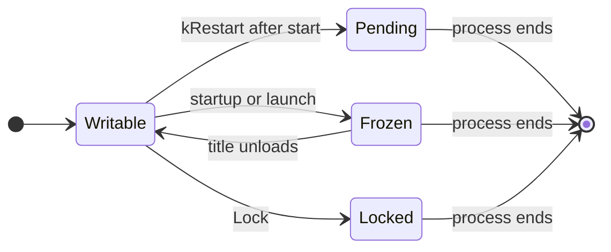

# Settings

A setting is a named, typed value such as `gpu.vsync` or `app.log_root`. Every setting lives in the settings registry, `rex::SettingsRegistry`, which `REX_SETTINGS()` returns. The command line, the config file, the environment, the console overlay and your code all write to the registry. This page explains how settings are declared, which source wins when several set the same setting, and when a setting can change. See [Settings Reference](../reference/cvars.md) for every name.

## Declaring Settings

A settings class is a class that derives from `rex::SettingOwner` and declares each setting as a member with `REX_SETTING`. The class passes a scope to `SettingOwner`, and the full name of a setting is the scope, a dot and the member name. The class below declares `mixer.mute`, `mixer.volume` and `mixer.quality`:

```cpp
class MixerSettings : public rex::SettingOwner {
 public:
  MixerSettings() : SettingOwner("mixer") {}

  REX_SETTING(bool, mute, false, "Silence all output");
  REX_SETTING(f64, volume, 1.0, "Output volume", rex::Range{0.0, 1.0});
  REX_SETTING(std::string, quality, "high", "Resampler quality", rex::Allowed("low", "high"), rex::kRestart);
};
```

The arguments of `REX_SETTING` are the type, the member name, the default, the help text and any traits. A setting has the type `bool`, `i32`, `i64`, `u32`, `u64`, `f64`, `std::string` or `std::filesystem::path`.

A setting exists in the registry only while its class is registered. Register your settings classes in `App::OnConfigure`, which runs before the command line and the config file are read:

```cpp
rex::Result<void> MyApp::OnConfigure(rex::SettingsRegistry& settings) {
  return settings.Register(mixer_);
}
```

`SettingsRegistry::Register` fails when one of its full names is already registered or is an [old name](#old-names). Destroying a settings class removes its settings from the registry.

A path setting can refer to another setting by writing its name in braces, such as `{app.root}`. `Get()` replaces the reference with the current value of that setting, and a name in braces that is not a setting stays as written, together with every reference after it. For example, `app.log_root` defaults to `{app.root}/logs`, so a player who moves `app.root` also moves the log folder.

### Traits

A trait after the help text in `REX_SETTING` limits the values or changes when and where the setting applies. The examples are SDK settings.

| Trait | Effect | Example |
|---|---|---|
| `Range{min, max}` | Refuses a number outside the range. | `apu.gain` has `Range{0.0, 4.0}`, so `gain = 40` under `[apu]` in the config file stops startup with the file name and the reason. |
| `Allowed(...)` | Accepts only the listed texts in a string setting. | `log.level` accepts the level names from `trace` to `off`, so `warning` is refused. |
| `kRestart` | Applies a change at the next start of the program. | `gpu.resolution_scale_x` can be changed in the settings overlay, and the new scale applies after a restart. |
| `kStartupOnly` | Refuses writes once the systems have started. | `apu.driver` selects the audio driver module, which loads during startup. |
| `kUntilLaunch` | Refuses writes while a title runs. | `kernel.user_language` and `runtime.title_memory_mb` are read when the title loads. |
| `kNoSave` | Keeps the value out of the config file. | `app.name` is set by the `App` constructor on every start. |
| `kDebugOnly` | Hides the setting from the settings overlay outside Debug builds. | A switch that helps only while you debug your own code. No SDK setting uses it. |
| `kKeyChord` | Makes the settings overlay capture the value from the keyboard. | `ui.bind.console` is the key that opens the console overlay, `Backtick` by default. |

See [When a Setting Can Change](#when-a-setting-can-change) for the exact points where `kRestart`, `kStartupOnly` and `kUntilLaunch` take effect.

## Layers

Each value carries the layer that wrote it. A layer is a rank for the source of a value, and only a write from the same or a higher layer can replace the value. From lowest to highest:

| Layer | `SettingLayer` | Source |
|---|---|---|
| default | `kDefault` | The default declared in `REX_SETTING`. |
| title | `kTitle` | Your code, before the title launches. |
| file | `kFile` | The config file. |
| environment | `kEnvironment` | A `REX_` environment variable. |
| command line | `kCommandLine` | A `--scope.name` option. |
| runtime | `kRuntime` | The console overlay, the settings overlay, and your code while a title runs. |
| lock | `kLock` | A value locked by your code. No later write replaces it. |

The order lets your program change a default without taking the choice from the player. A value that your code sets in `OnConfigure` is lower than the config file, the environment and the command line of the player. A change in an overlay while the program runs is higher than all three. For example, a program that sets `ui.video_mode_width` to 1920 in `OnConfigure` starts at 1920, and `--ui.video_mode_width=1280` on the command line starts it at 1280.

A source that the registry applies, such as the config file, loses to a higher layer without an error. A write from your code that loses returns an error, for example a `Set()` in `OnInit` on a setting that the player gave on the command line.

## Reading and Writing

A `Setting` member has these calls:

- `Get()` returns the value.
- `Set(value)` writes at the title layer before the title launches and at the runtime layer after. It returns an error when the setting is frozen or locked, when a higher layer holds the value, or when the value is refused.
- `Lock(value)` writes at the lock layer. It returns an error when the setting is frozen or locked, or when the value is refused.
- `Reset()` returns the setting to its default and clears its layer.

`SettingsRegistry::SetText(name, text)` writes a setting by name from text at the runtime layer. An overload takes the layer to write at. See `SettingsRegistry` and `Setting` in the API reference for the calls that find, list, load and save settings.

### Locking a Value

Use `Lock()` for a value that your program depends on and that the player must not change. Call it in `OnConfigure`, before the config file and the command line are read. The config file, the environment and the command line then skip the setting, and a later `Set()` or overlay write returns an error. For example, a program that renders correctly only at 1280 by 720 locks the video mode:

```cpp
rex::Result<void> MyApp::OnConfigure(rex::SettingsRegistry& settings) {
  auto& ui = GetUI().GetSettings();
  REX_TRY_VOID(ui.video_mode_width.Lock(1280));
  REX_TRY_VOID(ui.video_mode_height.Lock(720));
  return settings.Register(mixer_);
}
```

### Change Callbacks

Code that keeps its own copy of a value, instead of calling `Get()` on each use, needs to know when the value changes. The logger, for example, applies a new `log.level` to its output, and the UI resizes the window when `ui.window_width` changes.

`OnChange(fn)` registers a function that runs after each change, with the new value, on the thread that made the change. That can be the thread of the console overlay or the settings overlay, so the window settings post their work to the UI thread.

`OnChange` returns a `rex::ScopeGuard` from `rex/utility.h`. A `ScopeGuard` holds one function and runs it once, when the guard is destroyed, reset or assigned over. Here the function removes the callback, so the callback stays registered exactly as long as you keep the guard. Store it as a member of the object that the callback uses, so the callback stops before the object is destroyed:

```cpp
class Mixer {
 public:
  explicit Mixer(MixerSettings& settings)
      : volume_watch_(settings.volume.OnChange([this](const f64& volume) { SetGain(volume); })) {}

 private:
  void SetGain(f64 volume);

  rex::ScopeGuard volume_watch_;
};
```

Other SDK calls that register something until you release it, such as `Logger::AddSink`, return a `ScopeGuard` the same way.

## Sources and Precedence

Each source writes at its own [layer](#layers), so the order in which `App::Init` reads the sources does not affect which value wins.

### Startup Order

`App::Init` applies the sources in this order:



The app takes the instance lock and reads `app.config_file` before it applies the environment, so `REX_APP_SINGLE_INSTANCE` and `REX_APP_CONFIG_FILE` have no effect. Set these two on the command line or in `OnConfigure`.

A program with no `App` registers its settings classes with `REX_SETTINGS()` and calls `SettingsRegistry::Load` itself. `Load` writes at the runtime layer unless you pass another layer.

### Command Line

| Form | Meaning |
|---|---|
| `--scope.name=value` | Sets the value. |
| `--scope.name value` | Sets the value when the next token does not start with two hyphens. |
| `--scope.name` | Sets a bool to `true`. |
| `--no-scope.name` | Sets a bool to `false`. |

Put positional arguments before the options, or write each option as `--name=value`, because a positional argument after `--scope.name` is read as its value.

Seven older options without a scope are accepted. Six of them, such as `--game_data_root` and `--config_file`, each set one setting. `--modules` sets no setting and logs a warning. Each fails with "unknown option" when it has no value. See [Command Line Options](../reference/cvars.md#command-line-options) for the list.

An action that your program declares in `GetActions`, such as `--version`, is not a setting. The app passes it to `OnAction`.

### Config File

Every app reads the TOML file at `app.config_file`, `{app.root}/{app.name}.toml` by default.

- `--config_file` or `--app.config_file` replaces the path.
- An empty path reads no file.
- A missing file is not an error.
- A file that fails to parse stops startup.

```toml
[gpu]
vsync = false
resolution_scale_x = 2
```

- The flat form `"gpu.vsync" = false` is the same.
- The table `[gpu.xenos]` holds the `gpu.xenos` settings.
- An array is an error.

### Environment

A setting reads the variable `REX_` followed by its full name in capitals, with each dot turned into an underscore. For example, `app.log_root` reads `REX_APP_LOG_ROOT`.

### Console Overlay

The console overlay is the in app console that opens with `ui.bind.console`. It reads and writes settings by name:

| Input | Effect |
|---|---|
| `help` | Lists every setting and command with its value and help text. |
| `gpu.vsync` | Prints the value. |
| `gpu.vsync false` | Sets the value at the runtime layer. |
| `console.find vsync` | Lists the setting and command names that contain the text. |
| `clear` | Empties the output. |

## When a Setting Can Change

A setting with none of the traits below accepts writes at any time. These traits close or delay writes at fixed points:

- A `kStartupOnly` setting is frozen once the systems have started, right before `OnInit`. The `app` path settings, `hid.drivers`, `apu.driver`, `ui.driver` and `gpu.driver` are `kStartupOnly`.
- A `kUntilLaunch` setting is frozen when `TitleRuntime::Launch` starts the title, and writable again once the title unloads.
- A `kRestart` setting accepts writes at any time. Once the startup settings are frozen, a new value is pending. `Get()` keeps returning the old value until the next start of the program.
- A locked setting refuses every later write.



A write to a frozen setting returns an error with "can no longer change". A write to a locked setting returns an error with "is locked".

- `Setting::IsRestartPending` reports a pending value.
- `SettingsRegistry::GetRestartPending` lists the settings with a pending value.
- `App::RequestRestart` shuts the app down and starts the process again with the same arguments. The new process reads its values from the sources again, so a value set in an overlay or from code applies at that start only after `SettingsRegistry::Save` writes it to the config file.

`rex::Shutdown` ends the settings session. It returns every setting to its default and clears every lock and freeze.

## Values and Errors

- A bool is `true`, `1`, `false` or `0`.
- An integer must parse in full as a decimal number, with no plus sign, no minus sign on an unsigned type and no spaces.
- A value outside the range or the allowed list is refused, never clamped. Only the settings overlay clamps a number typed into it.

What happens to a refused value depends on its source:

- On the command line, it stops startup with the setting, the text and the reason.
- In the config file, it stops startup with the file name and the reason. The values from the file that were applied before it stay applied.
- In the environment, it logs a warning and is ignored.
- For a setting whose class registers later, it logs a warning when the class registers and is ignored.
- From `SettingsRegistry::SetText` or `Set()`, it returns an error and keeps the old value.
- `--no-scope.name` on a setting that is not a bool stops startup.

### Unknown Names

After `OnInit`, the app reports every name that a source set and that no registered settings class declares:

- A name from the command line stops startup with "unknown setting 'name' from CommandLine".
- A name from the config file logs the warning "unknown setting 'name' from Config".
- An environment variable for an unknown name is never read.
- An option that is not shaped like a setting name stops startup with "unknown option".

An unknown name given both on the command line and in the config file stops startup, because the command line is the higher source.

## Values Before Registration

A source can refer to a setting before its class is registered. Driver modules load after the command line and the config file are read, so `--ui.sdl.video_driver=dummy` refers to a setting that exists only once the SDL3 UI driver starts.

- The registry keeps the value and applies it when the class registers.
- A setting that registers after the environment was applied reads its environment variable when it registers.

## Old Names

`SettingsRegistry::AddAlias(old_name, new_name)` makes an old name apply to the new setting from the config file, the command line, the console overlay and `SetText`. The environment is read only under the new name. Use it when you rename a setting, so config files and command lines that use the old name keep working. For example, after a rename of `mixer.volume` to `mixer.gain`, call `AddAlias("mixer.volume", "mixer.gain")`.

- The app logs a warning for each use of an old name once the log is open.
- An alias to an empty name marks a removed setting. Its values are ignored with a warning.
- The SDK's own old names work before the class that declares the new name registers. For example, `bind.console` applies to `ui.bind.console`.

See [Old Names](../reference/cvars.md#old-names) for the SDK list.

A `log.file` value that is a path is an old form. It sets `log.file` to true, `log.file_name` to the file name and, when the path has a folder, `app.log_root` to that folder.

## Saving

`SettingsRegistry::Save` writes every setting whose value differs from its default to a TOML file, under its current name, with one table per scope.

- It skips commands and `kNoSave` settings.
- It replaces the whole file, so comments and unknown keys are lost.
- The **Save to config** button of the settings overlay writes to `app.config_file`.

A saved pending `kRestart` value applies at the next start unless the environment or the command line sets another.

## Commands

A command is an action that the console overlay runs by name, such as `console.find`. It has no value.

- `REX_COMMAND` from `rex/console_command.h` declares a command in a settings class. Its full name follows the same rule as a setting.
- `SettingsRegistry::Run(name, args)` runs a command on the calling thread.
- `SettingsRegistry::EnumerateCommands` lists the registered commands.

## Settings Classes

A program reaches the SDK settings classes in this table from code. [Settings Reference](../reference/cvars.md) lists every scope.

| Class | Scope | How to reach it |
|---|---|---|
| `App` | `app` | The settings are members of the app. |
| `PathSettings` | `app` | `REX_PATHS()` |
| `InputSettings`, `GraphicsSettings`, `AudioSettings`, `UISettings` | `hid`, `gpu`, `apu`, `ui` | `GetSettings()` on `IInputSystem`, `IGraphicsSystem`, `IAudioSystem` or `IUISystem` |
| `Logger` | `log` | `REX_LOGGER()` |
| `TitlePaths` | `title` | `TitleRuntime::GetTitlePaths` |
| `RuntimeSettings` | `runtime` | `TitleRuntime::GetRuntimeSettings` |
| `KernelSettings` | `kernel` | `TitleRuntime::GetKernelSettings` |
