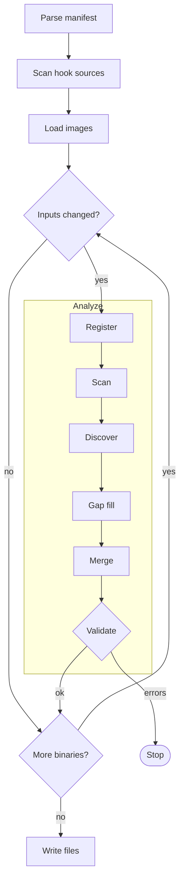

# Codegen Pipeline

`rexglue codegen` reads the [project manifest](../reference/manifest.md) and each XEX it lists, finds the functions in the PowerPC code, and writes a C++ function for each one. The project's CMake build runs it before compiling, and again whenever the manifest, an XEX or a hook source changes. [Generated Code](generated-code.md) shows what it writes.

## Binaries

The manifest lists the entrypoint, the XEX that runs first, and any DLL modules, the other XEX files that the game loads while it runs. Codegen handles each of them as a separate binary, with its own analysis and its own output folder.

- A DLL module is named by the file name of its XEX without the extension, with each `.` and space replaced by `_`.
- `--target` limits a run to the DLL modules you name. Codegen always processes the entrypoint.

For the files that `[[modules]]` adds to the entrypoint folder, see [Output Files](generated-code.md#output-files).

## Steps

Codegen loads its inputs once, analyzes each binary whose inputs changed, and then writes the C++ of every binary it analyzed.



A validation error in any binary stops the run before codegen writes anything, so all generated sources stay as they were. With `--force`, the errors become warnings and the run continues.

### Load

Codegen parses the manifest and the TOML files it includes. Keys at the top level of the manifest form the shared layer, which applies to every binary. See [Includes](../reference/manifest.md#includes) for how the shared layer merges into each binary.

Next, codegen reads the folders in `[project].hook_sources` for mid function hooks declared in C++ (see [Hook Sources](hooks.md#hook-sources)).

Then codegen loads the binaries with the SDK runtime, the same XEX loader that a program uses. The loader reads files from the game root, the folder that holds the game files. The game root is `[project].game_root`, or by default the folder of the entrypoint, and the entrypoint and every DLL module must be inside it.

### Incremental Output

Codegen skips a binary whose inputs have not changed since the last run.

- The output folder of each binary holds `codegen.stamp`, with a fingerprint of the inputs and the list of files that the last run wrote.
- A binary is skipped when its fingerprint matches and all of those files exist.
- `--ignore-stamp` and `--force` turn off the check.

The fingerprint hashes file content, not modification times. It covers:

- the SDK version, the built in templates, the [limits](../reference/cli.md#limits) and the analysis settings
- the mid function hooks read from the hook sources
- the XEX, the manifest and every included TOML file
- every file under `template_dir`, the manifest key that points to a folder of templates to use in place of the built in ones

## Analysis

Analysis builds the list of functions in a binary, with the start, the end and the code of each. It runs in six phases.

### Register

Analysis starts from the functions that the binary and the manifest list:

- Import thunks. An import thunk is a short stub through which guest code calls a function of another module. A thunk for an xboxkrnl, XAM or XBDM function becomes `__imp__` and the export name, and a thunk for any other module becomes `sub_` and its address.
- Millicode. The compiler that built the XEX saves and restores the non volatile registers through shared helper routines, such as `__savegprlr_14` and `__restgprlr_14`, called millicode. Analysis finds them by their instruction patterns.
- The `[functions]` entries of the manifest.
- The `.pdata` entries. `.pdata` is the section in which the compiler writes the start and length of most functions, for exception unwinding.
- The handlers, filters and unwind actions that the C++ exception tables and the SEH tables of the binary list.

A call to the manifest's `longjmp_address` becomes a `ppc_longjmp` call, and analysis treats that function as one that does not return. See [Names](generated-code.md#names).

### Scan

Scan splits each executable section into code regions, the runs of instructions between zero words.

### Discover

Discover follows the instructions of each registered function from its start and splits them into basic blocks.

- A function sized by `.pdata` or a `[functions]` entry stays inside that size.
- Discover reads any other function up to the end of its code region.

New functions come from three places:

- A `bl` to an address outside the current function makes that address a function.
- A `bctr` (an indirect branch through the count register) with no condition is read as a jump table, the table of addresses through which a `switch` statement branches. Analysis reads the targets from the table, unless a `[[switch_tables]]` entry gives them. A target past the end of the function extends the function.
- The vtable scan finds the vtables of C++ classes, the tables of virtual function pointers, through the MSVC RTTI complete object locators in `.rdata`, and makes every slot a function.

A `b` to an address outside the current function stays a pending jump until Merge resolves it.

See [Limits](../reference/cli.md#limits) for the limits on passes and jump table entries.

### Gap Fill

Gap fill adds a function for code that no function covers, when that code reaches a return or a branch.

### Merge

Merge resolves each pending jump. A target inside the function is a label, and a target at the start of another function or an import is a tail call.

Merge also marks register sharing functions, which use the registers of their caller instead of their own:

- the funclets that the exception tables list, the small functions that the compiler makes from `__finally` and `__except` blocks and from C++ `catch` blocks and unwind actions
- every `[functions]` entry with `share_registers = true`

### Validate

Validate checks every direct `b` and `bl`. A branch fails when its target is outside the current function and inside no function that codegen knows, and when it enters a millicode run anywhere other than one of its entries. Each failure is an analysis error, and any error stops the run unless `--force` is passed. [Getting Started](../getting-started.md#fix-analysis-errors) shows how to fix one.

## Writing the Files

Each function becomes a `DEFINE_REX_FUNC` body, the form shown in [A Generated Function](generated-code.md#a-generated-function). The body of a function with SEH scopes gets exception wrappers only when `generate_exception_handlers` is true.

### Partitioning

Codegen splits the functions of a binary across numbered source files of about `--max_file_size_bytes` each, 1 MiB by default. It keeps each function in the same file from one run to the next, and keeps the placements in `codegen.partition.json`. Removing that file or changing `--max_file_size_bytes` places all functions again.

- Codegen rewrites only the files whose content changed.
- Codegen removes the generated files that this run did not write, including the files of an earlier prefix after a change to `[project].name`.

## Optimizations

The flags below are [manifest settings](../reference/manifest.md#register-and-codegen-flags). Each defaults to false, and `rexglue init` writes none of them. `[vector_math]` defaults to fast.

`skip_lr`, `skip_msr` and fast vector math can make the game behave differently than on the console.

### Tail Calls

A branch to another function is written as `REX_MUSTTAIL return name(ctx, base);`, which Clang compiles to a guaranteed tail call, so a chain of such branches runs in constant host stack. See [Calls and Branches](generated-code.md#calls-and-branches).

Some branches are written as a call followed by `return;` instead, such as a branch with an `after` hook, a branch in an SEH function and a branch to an import.

### Restore Exits and Millicode

A restore exit is a branch to a millicode restore helper at the end of a function, which restores the non volatile registers and returns.

- `non_volatile_as_local` removes every call to a save or restore helper, and a restore exit becomes `return;`.
- The removal skips a function that is millicode itself, a register sharing function, and a function with SEH scopes when `generate_exception_handlers` is true.

### Registers in Locals

A generated function keeps the guest registers in `PPCContext`, the register state of the guest thread. The `*_as_local` flags move them into C++ locals, which Clang can keep in host registers.

| Flag | Registers in locals |
|---|---|
| `ctr_as_local` | `ctr` |
| `xer_as_local` | `xer` |
| `reserved_as_local` | `reserved` |
| `cr_as_local` | `cr0` to `cr7` |
| `non_argument_as_local` | `r0`, `r11`, `r12`, `f0`, `v32` to `v63` |
| `non_volatile_as_local` | `r14` to `r31`, `f14` to `f31`, `v14` to `v31` and `v64` to `v127` |

- `r1` to `r10`, `r13`, `f1` to `f13` and `v0` to `v13` always stay in `ctx`.
- The general, float and vector flags do not apply inside millicode, and `non_volatile_as_local` skips the functions listed under [Restore Exits](#restore-exits-and-millicode).

### Link and Machine State Registers

`skip_lr` removes the writes to the link register, except for a `bl` to an import. Use it only for a title that never reads the link register as data.

`skip_msr` removes the global lock, which `mtmsrd` from `r13` enters, any other `mtmsrd` leaves and `mfmsr` reads. Use it only for a title that does not use that lock for mutual exclusion.

### Stack Slot Forwarding

With `forward_stack_stores`, a load through `r1` reuses a value written through `r1` at the same offset and width in the same basic block, without reading guest memory.

```cpp
fwd0.u32 = ctx.r11.u32;
REX_STACK_STORE_U32(ctx.r1.u32 + 80, fwd0.u32);
// ...
ctx.r3.u64 = fwd0.u32;
```

### Memory Accesses

The GPU and APU registers are memory mapped (MMIO). Guest code reads and writes them as memory at fixed guest addresses, in two register blocks. Codegen classifies every load and store by its address.

- A 32 bit access whose address codegen can prove is in a register block calls the handler of that block.
- An `[mmio.gpu]` or `[mmio.apu]` entry declares an access whose address the analysis cannot prove.
- An access of another width to a block, and any access that might reach a block, tests the address at runtime.
- An access through `r1` skips the offset that addresses from `0xE0000000` take (see [Memory](generated-code.md#memory)), because every guest stack lies below `0xE0000000`. Debug builds assert it.

See [Memory](generated-code.md#memory) for the macros and [MMIO Blocks](../runtime/memory.md#mmio-blocks) for the blocks.

### Vector Math

The `[vector_math]` table selects fast or exact code for the fused multiply add forms, the dot products and the estimates.

- Fast, the default, uses host SIMD arithmetic, whose rounding and denormal results differ from the console.
- Exact gives results that match the console bit for bit.

See [`[vector_math]`](../reference/manifest.md#vector_math).
