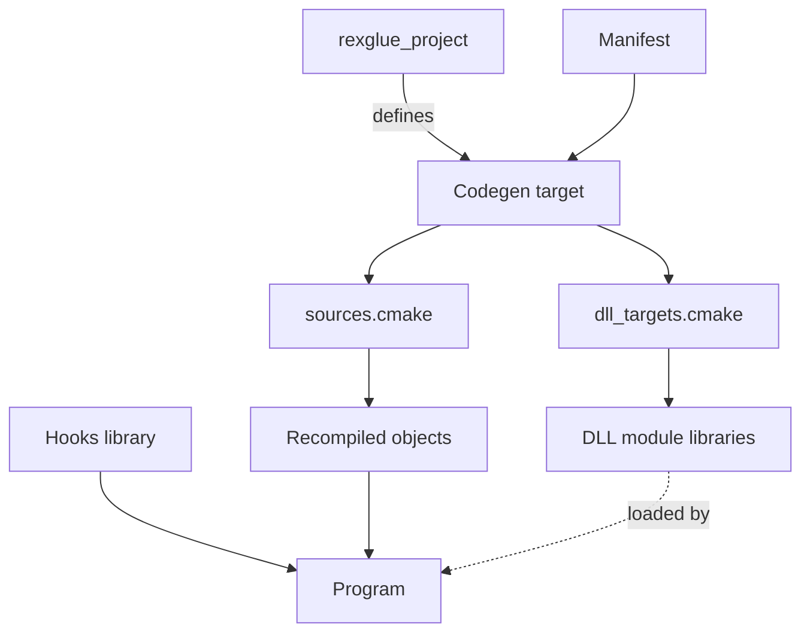

# Generated Code

`rexglue codegen` writes C++ source files for each binary in the manifest. This page shows what those files contain and how the build compiles them. [Codegen Pipeline](codegen-pipeline.md) lists the steps that produce them. The examples use the project `foobar` from [Getting Started](../getting-started.md).

Do not edit the generated files. Each time codegen regenerates a binary, it rewrites every file of that binary whose content differs from what it writes. To change generated behavior, use the [manifest](../reference/manifest.md) and [hooks](hooks.md).

## Output Files

Codegen writes each binary into the folder given by the binary's `out_directory_path`, relative to the manifest. Two binaries cannot share a folder. For `foobar`, `rexglue init` sets the entrypoint folder to `generated/default`.

Every C++ file name starts with a prefix, which is `[project].name` for every binary, DLL modules included. The `project_name` key in a [binary table](../reference/manifest.md#binary-tables) sets another prefix for that binary. For `foobar`, the names start with `foobar_`, such as `foobar_pch.h` and the numbered files `foobar_recomp.0.cpp` and up. See [Generated Files](../appendix/generated-files.md) for the purpose of each file.

The entrypoint folder also holds `codegen.d` and `codegen.build.stamp`, which the build uses to rerun codegen. When the manifest lists `[[modules]]`, it holds `module_registry.cpp` and `dll_targets.cmake` too.

- To replace a built in template for the headers, the init file, the register file or `sources.cmake`, add a file `codegen/` plus the template name and `.inja`, such as `codegen/pch_h.inja`, to the folder that the manifest key `template_dir` points to.
- The templates for `module_registry.cpp` and `dll_targets.cmake` cannot be replaced.

### The Precompiled Header

`foobar_pch.h` is the precompiled header of the generated sources. It defines:

- the image constants `REX_IMAGE_BASE`, `REX_IMAGE_SIZE`, `REX_CODE_BASE` and `REX_CODE_SIZE`, the guest address and size of the loaded image and of its code
- a `REX_CONFIG_` define for each register flag that the manifest turns on, such as `REX_CONFIG_SKIP_LR`
- the macros that generated code uses for functions, memory accesses and calls

## A Generated Function

```cpp
DEFINE_REX_FUNC(sub_82010000) {
	REX_FUNC_PROLOGUE();
	// b 0x82010200
	REX_MUSTTAIL return sub_82010200(ctx, base);
}
```

- Every function has the signature `void name(PPCContext& ctx, u8* base)`.
- `ctx` is the register state of the calling guest thread.
- `base` is the host address of the 4 GiB guest memory mapping.
- A comment with the disassembly comes before the code of each guest instruction.
- Labels are `loc_` and the guest address, such as `loc_821F0010`.

`DEFINE_REX_FUNC` defines the body as `__imp__name` and adds a weak symbol `name` that a [hook](hooks.md#weak-symbols) can replace. On Windows and Linux, `name` is a weak alias of `__imp__name`. Mach-O on macOS has no overridable alias, so there `name` is a separate weak function that tail calls `__imp__name`.

Imports and `[shim]` functions have no body in the numbered files. `foobar_funcs.h` declares them, and `foobar_register.cpp` defines each import from another recompiled module.

### Names

Codegen names a function that is not an import by the first rule that applies:

| Function | Name |
|---|---|
| Shim in `[shim]` | `rexshim_` and the shim name, defined by the SDK |
| Entry point of a binary, DLL modules included | `xstart` |
| Named by the manifest or a millicode helper | The given name |
| Any other function | `sub_` and the guest address in upper case hex, such as `sub_82010000` |

- An import of an xboxkrnl, XAM or XBDM function is `__imp__` and the export name, such as `__imp__NtCreateFile`.
- An import from any other module is `sub_` and the address of its thunk.

### Registers

`PPCContext` holds the registers of a guest thread:

- `r0` to `r31`, `f0` to `f31` and `v0` to `v127`
- `cr0` to `cr7`, `lr`, `ctr`, `xer`, `reserved`, `msr`, `fpscr` and `vscr`

An integer or float register is a union with views such as `.u32`, `.s64` and `.f64`. A condition register field has the bits `lt`, `gt`, `eq` and `so`.

See [Registers in Locals](codegen-pipeline.md#registers-in-locals) for the registers that codegen can move into locals.

### Memory

Guest memory is big endian, so every load and store swaps the bytes. Generated code reaches guest address `A` at host address `base + A`.

!!! note "Addresses from 0xE0000000"
    On macOS on arm64, and on Linux on aarch64 when the CMake option `REX_PHYSICAL_OFFSET_IN_CODE` is `ON`, every access to an address of `0xE0000000` or above adds `0x1000`, through `REX_PHYS_HOST_OFFSET`. On the console, guest address `0xE0000000` is physical address `0x1000`. The MMU page of those hosts is larger than `0x1000` bytes, so a memory view cannot start at physical address `0x1000`. The SDK starts the view at physical address 0 and the generated code adds the difference. Accesses through `r1` skip the offset, since every guest stack lies below `0xE0000000`. On Windows, on Linux on x86_64 and on macOS on x86_64, the view starts at physical address `0x1000` and `REX_PHYS_HOST_OFFSET` is 0. The definition `REX_PHYSICAL_OFFSET_IN_CODE` comes from `rex::base`, so a target that links `rex::sdk` gets the value the SDK was built with. See [Address Translation](../runtime/memory.md#address-translation).

The GPU and APU registers are memory mapped (MMIO). Guest code reaches them by reading and writing two blocks of guest addresses (see [MMIO Blocks](../runtime/memory.md#mmio-blocks)). Codegen picks a macro for each access by its address and width:

| Access | Load macros | Store macros |
|---|---|---|
| Plain | `REX_LOAD_U8`, `REX_LOAD_U16`, `REX_LOAD_U32`, `REX_LOAD_U64` | `REX_STORE_U8`, `REX_STORE_U16`, `REX_STORE_U32`, `REX_STORE_U64` |
| Plain, with `r1` as the base register | `REX_STACK_LOAD_U8`, `REX_STACK_LOAD_U16`, `REX_STACK_LOAD_U32`, `REX_STACK_LOAD_U64` | `REX_STACK_STORE_U8`, `REX_STACK_STORE_U16`, `REX_STACK_STORE_U32`, `REX_STACK_STORE_U64` |
| GPU register, 32 bit | `REX_GPU_LOAD32` | `REX_GPU_STORE32` |
| APU register, 32 bit | `REX_APU_LOAD32` | `REX_APU_STORE32` |
| Guarded | `REX_MM_LOAD_U8`, `REX_MM_LOAD_U16`, `REX_MM_LOAD_U32`, `REX_MM_LOAD_U64` | `REX_MM_STORE_U8`, `REX_MM_STORE_U16`, `REX_MM_STORE_U32`, `REX_MM_STORE_U64` |

A guarded access is one that might reach a register block, or an access of a width other than 32 bits to a block. It tests the address at runtime. Outside the blocks it takes the plain path. Inside a block, a 64 bit write is made as two 32 bit writes, and a write narrower than 32 bits ends the process (see [Misses](../runtime/memory.md#misses)). The GPU and APU macros call the handler that the runtime attached to the block (see [Attaching a Recipient](../runtime/memory.md#attaching-a-recipient)).

`codegen.mmio.json` lists the loads and stores that reach or might reach a register block, and those in the `0x7F000000` range outside both blocks:

| List | Meaning |
|---|---|
| Matched | The address is in a register block. |
| Declared | The manifest lists the site. |
| Guarded | The address might reach a block. |
| Unserved | The address is in the `0x7F000000` range, outside both blocks. |
| Unsupported | The site reaches a block through an instruction that codegen cannot route. The site stays a plain access, and codegen logs an error. |

Each `[mmio.gpu]` or `[mmio.apu]` [manifest](../reference/manifest.md#mmio) entry must point to a load or a store that codegen routes to that block, in the matching `read` or `write` array. Codegen fails on any other entry.

### Calls and Branches

| Guest instruction | Generated C++ |
|---|---|
| `bl` to a function or an import | `ctx.lr` set to the return address, then `name(ctx, base);`. `skip_lr` removes the first line for a guest function. |
| `b` inside the function | `goto` to the label |
| `b` to another function | `REX_MUSTTAIL return name(ctx, base);`, except in the cases under [Tail Calls](codegen-pipeline.md#tail-calls) |
| Conditional branch inside the function | `if` on the condition bit, then `goto`, such as `if (cr0.eq) goto loc_821F0010;` |
| `bctr` with a jump table | A `switch` over the index register. The default case and a null target are `__builtin_trap()`. |
| `bctr` with no table | `REX_TAIL_INDIRECT_FUNC` in tail position, otherwise `REX_CALL_INDIRECT_FUNC` and then `return;` |
| `bctrl`, `blrl` | `REX_CALL_INDIRECT_FUNC` |
| `blr` | `return;` |
| `bl` to an address with no function | `REXCPU_FATAL` |

An indirect call finds the host function for its guest target in the [function table](#function-table).

### Exception Scopes

When `generate_exception_handlers` is true, codegen wraps a function with SEH scopes (`__try`, `__except` and `__finally`) in one `REX_SEH_TRY` and `REX_SEH_CATCH_ALL` block, and turns each `return;` into `REX_SEH_RETURN;`. On a hardware fault the catch block:

1. Calls the `__finally` handlers of the scopes that have no filter, in reverse order.
2. Calls the register restore helper of the function.
3. Rethrows.

Such a function never keeps non volatile registers in locals. The recompiled sources need asynchronous exception handling, which the build turns on (see [`rexglue_recomp_options`](../reference/cmake.md#rexglue_recomp_options)).

## The Init File

`foobar_init.cpp` connects the generated code to the runtime. It defines:

- `kPPCImageConfig`, a `rex::ppc::PPCImage` that holds the image constants, the register flags and pointers to the tables below. For an entrypoint with DLL modules it also points to the function that registers them.
- `kPPCFuncMappings`, the guest address and host function of every import and of every function at or above the code base, ending with `{ 0, nullptr }`.
- `kPPCCallUsage`, the argument registers, `r3` to `r10` and `f1` to `f13`, that each function reads at entry.

The `src/main.cpp` that `rexglue init` writes includes `foobar_init.h`, passes `kPPCImageConfig` to the `TitleApp` constructor, and declares the app with `REX_TITLE_APP`. [`TitleRuntime::Load`](../runtime/lifecycle.md#load) reads the mappings into the function table. A project created before this name changed has to rename `PPCImageConfig` to `kPPCImageConfig` in its own `src/main.cpp` by hand.

### Function Table

The function table maps each guest code address to its host function. Every indirect call, such as a call through a function pointer or a vtable, reads it.

- `GuestAddressSpace::InitializeFunctionTable` reserves a zeroed table in guest memory at `REX_IMAGE_BASE + REX_IMAGE_SIZE`, in the `v80000000` heap.
- The table is `(code_size + 0x10000) * 2` bytes, an 8 byte host pointer for every 4 byte instruction, with room for `0x10000` bytes of thunks after the code.
- The slot of a guest address is at `table_base + (address - code_base) * 2`. `GuestAddressSpace::SetFunction` writes a slot.

A call to an address with no slot in the table, or with an empty slot, asks the runtime to find the function in every loaded module.

## Build Integration

The SDK package provides `rexglue_project` and the `rexglue_setup_*` functions, so no generated CMake file is needed. The project's `CMakeLists.txt` calls `rexglue_project`, which defines the codegen target and the settings that connect the generated files to the program. The output folder holds only what codegen writes, so nothing in it needs to be committed.



- `foobar_codegen` runs `rexglue codegen`, and reruns it when an input listed in `codegen.d` changes.
- `sources.cmake` lists the generated `.cpp` files of a binary. A change to it makes CMake configure again.
- `rexglue_setup_target` builds the entrypoint sources into the object library `foobar_recompiled`, with the precompiled header, and links it into the program.
- `CMakeLists.txt` builds your hook sources into the object library `foobar_common`, which the program links. See [Weak Symbols](hooks.md#weak-symbols) for why it is an object library.
- `dll_targets.cmake` defines a shared library for each DLL module, built into the folder of the program, which loads it at runtime.
- All of these targets link `rex::sdk`.

See [CMake](../reference/cmake.md) for the functions.
