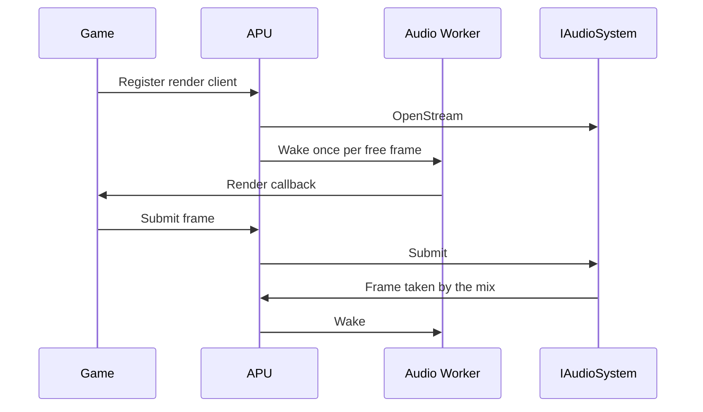

# Audio

An Xbox 360 game produces sound in two parts. It mixes its sound into frames of samples and hands each frame to the system through a render client, a callback that the system calls when it can take more audio. Compressed music and effects are in XMA, a format that the console decodes in the APU, its audio hardware.

The SDK splits this work the same way. The audio system mixes the streams of samples and plays them on the host through an audio driver. The kernel side, which runs inside the runtime, serves the render clients and decodes XMA.

## Audio System

`App::GetAudio()` returns the audio system as `IAudioSystem`, and the `rexapu` system library provides it. See [System Libraries](../app/modules.md#system-libraries) for what `rexapu` requires.

The audio system plays through the driver that `apu.driver` names. The default is `sdl3`. See [Driver Modules](../appendix/binaries-and-modules.md#driver-modules) for the audio driver module. With `none`, a program that does not require audio plays no sound. A program that requires audio, such as a `TitleApp`, fails startup with `none` or when no audio driver is available.

### Streams and Frames

A client of the audio system opens a stream and submits frames to it. A frame is 256 samples on each of six channels at 48000 Hz, in this order:

1. Front left
2. Front right
3. Center
4. LFE, the low frequency effects channel for a subwoofer
5. Surround left
6. Surround right

At most eight streams can be open at once.

### Mix

The host audio device asks for samples at its own pace. Each time it needs more, the audio system mixes one period, the length of one frame:

- It takes the next frame from each open stream and adds them together. A stream with nothing queued adds silence and counts as an underrun.
- It applies `apu.gain`, and mutes the output when `apu.mute` is on, or when `apu.mute_unfocused` is on and the window has no focus.
- It mixes down to the channels of the device. `IAudioSystem::GetOutputChannels` returns 6 for a surround device and 2 for stereo, and 2 while no device is open.

With `apu.peak_limit` above 0, a stream whose peak stays above the limit for two periods in a row fades to silence, and fades back in once a frame comes back under the limit. A frame with a sample that is not a finite number is silenced immediately. These guards keep a broken stream from producing loud noise.

`IAudioSystem::GetStats` returns the open streams, the queued frames, the underruns and the average latency from submit to the device.

## Guest Audio

The game reaches audio through kernel exports, which the APU of the runtime serves. `TitleRuntime::Launch` starts the APU, with its XMA decoder and the `Audio Worker` thread, when it attaches the game to the systems. If the APU fails to start, the runtime logs a warning and the game runs without audio.

A game registers a render client with `XAudioRegisterRenderDriverClient`. The APU then opens a stream on the audio system for the client, and the `Audio Worker` thread calls the client's callback each time the stream can take another frame:

1. At registration, the stream can queue `apu.max_queued_frames` frames, so the worker calls the callback that many times.
2. In the callback, the game mixes a frame and submits it with `XAudioSubmitRenderDriverFrame`, and the APU submits it to the stream.
3. Each time the mix takes a frame from the stream, one more frame is free, and the worker calls the callback again.

The worker is a kernel thread, so the callback runs as guest code like any other game thread. At most eight render clients can be registered.

## XMA Decoder

The XMA decoder of the APU has 320 contexts. A context is a block in guest memory that holds the state of one XMA stream: its input buffers, its output buffer and its decode state. The decoder decodes the contexts with FFmpeg on the `XMA Decoder` thread.

A game reaches the decoder through the XMA kernel exports, or by writing the contexts and the APU registers, as it would on the console. `TitleRuntime::SetAudioPaused` pauses both the decoder and the `Audio Worker`.

## MMIO Block

Recompiled code reaches the APU registers through the MMIO block at `0x7FEA0000`. The XMA decoder attaches the block, as `MMIOBlock::kAPU`, when the APU starts during `TitleRuntime::Launch`. See [MMIO Blocks](../runtime/memory.md#mmio-blocks).

## Threads

| Thread | Started by | Runs |
|---|---|---|
| `Audio Worker` | `TitleRuntime::Launch` | The render client callbacks, as a kernel thread. |
| `XMA Decoder` | `TitleRuntime::Launch` | The XMA decoding. |
| Mix thread, unnamed | `IAudioSystem` | The mix on a timer while no device is open, and the check for a lost device. |

When the device is lost, the mix thread closes it, mixes on its timer, and tries to open the device again after about one second. See [Startup Order](../app/app-lifecycle.md#startup-order) for when each step runs.
