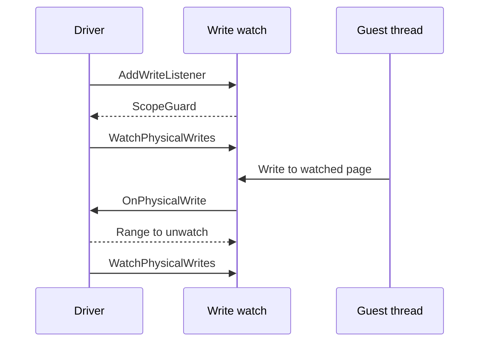

# Driver Context

A system or driver runs before a game launches and after it exits, so it does not look up the running game. It receives what it needs at two points:

- When a driver starts, it receives an `IDriverContext` from `rex/driver_context.h`, which serves the settings registry, the logger and the UI thread.
- When a game launches, the runtime attaches it to each system. The system then receives the game interfaces it needs, and gives them back when the game exits.

## Driver Start

`IDriver::Initialize` receives the `IDriverContext`. A driver registers its settings and adds its log categories through it.

Some host libraries, such as SDL, must run on the thread that owns the window. `IDriverContext::RunOnUIThread` runs a function on the UI thread and waits for it, and `PostToUIThread` queues a function there and returns immediately.

## Title Attach

`TitleRuntime::Launch` attaches the game to the systems. These are the interfaces the game hands over:

| Type | Header | Purpose |
|---|---|---|
| `TitleInfo` | `rex/title.h` | Holds the title ID and the `VideoMode`. |
| `IPhysicalMemory` | `rex/guest.h` | Reads and writes guest physical memory. |
| `IPhysicalWriteWatch` | `rex/guest.h` | Reports writes to watched physical pages. |
| `IGuestInterrupts` | `rex/guest.h` | Starts host threads that can call into the game, and raises the graphics interrupt. |
| `IAchievementRegistry` | `rex/title.h` | Lists the achievements and their icons, and reports unlocks. |

Each system receives only what it uses:

- The graphics system receives `TitleInfo`, `IPhysicalMemory`, `IPhysicalWriteWatch` and `IGuestInterrupts`, and passes them to its driver in `IGraphicsDriver::AttachTitle`.
- The UI system receives `TitleInfo` and `IAchievementRegistry`, for the achievements overlay.
- The audio and input systems receive nothing. The kernel calls them through their public interfaces.

Several of these calls return a `ScopeGuard`, an object from `rex/utility.h` that runs a cleanup function once when it is destroyed. Destroying the guard undoes the call.

## Physical Memory

The Xenos GPU reads and writes memory by physical address, from `0` to `0x1FFFFFFF`. `IPhysicalMemory` takes these physical addresses. See [Physical Memory](../runtime/memory.md#physical-memory) for how physical memory relates to the guest address space.

Calls ignore guest allocation and page protection. A range that ends above `0x20000000` fails with a `kMemory` error, and nothing is read or written.

`CopyToPhysical` notifies the write listeners of the pages it writes. A write through the span that `GetWritablePhysicalSpan` returns notifies nobody.

### Fences

The game and the GPU signal each other through fences, 32 bit values in memory that one side writes and the other side waits on. `StoreRelease32` and `LoadAcquire32` write and read a fence:

- Both are atomic 32 bit accesses in big endian order.
- The address must be 4 byte aligned. A misaligned address returns a `kMemory` error.
- A `LoadAcquire32` that reads the value of a `StoreRelease32` sees every host write that the storing thread made before the store.

## Write Watches

A graphics driver keeps copies of guest memory on the host GPU, such as textures and vertex data. When the game writes that memory, the copies go stale. A write watch reports which pages changed. It calls a listener on the next write to a watched physical page. See [Write Watches](../runtime/memory.md#write-watches) for which writes call the listeners and which pages a watch covers.

A driver adds its listener once and then watches ranges:

1. `AddWriteListener` adds the listener and returns a `ScopeGuard`. Destroying the guard removes the listener, so the listener must outlive the guard.
2. `WatchPhysicalWrites` watches a range of physical addresses until the next write to it. A range that ends above `0x20000000` is ignored.
3. On a write to a watched page, `OnPhysicalWrite(range, exact)` runs on the writing thread, with the write watch lock held. `range` is in physical addresses and covers whole host pages.
4. If `exact` is false, the listener returns the largest range around `range` that it no longer needs watched, or `{0, 0xFFFFFFFF}` for any range. If `exact` is true, the return value is ignored.
5. A watch fires once. To watch the range again, the driver calls `WatchPhysicalWrites` after the listener returns.

The Xenos drivers use write watches in two places. Shared memory, the driver's copy of guest memory on the GPU, watches each range after it uploads it, and its listener marks the written pages for upload again. The primitive processor, which converts index data the host GPU cannot read as it is, watches that index data and removes its cached conversions when the data changes.

### Write Watch Lock

A `RankedMutex` carries a rank, and a thread may take it only when its rank is above every rank the thread holds. A Debug build reports a lock taken out of order. The write watch lock is a `RankedMutex` with the highest rank, `LockRank::kLeaf`, and it is not recursive. So while a thread holds it, in a listener or under `LockWriteWatches`, the thread must not:

- Call `AddWriteListener`, `WatchPhysicalWrites`, `LockWriteWatches` or `CopyToPhysical`.
- Destroy a listener guard.
- Take another `RankedMutex`.

`LockWriteWatches` takes the lock until the returned `ScopeGuard` is destroyed. A driver takes it while it changes the state that its listener reads, so no listener runs at the same time.

## Host Threads

Guest code runs only on threads that the kernel created, because each needs a guest thread state and a guest stack. A driver thread that calls into the game is such a thread. `IGuestInterrupts::StartHostThread(name, fn)` starts one:

- The function receives a `std::stop_token`.
- The call returns a `ScopeGuard`. Destroying it stops the thread and waits for it to end.

The game registers a graphics interrupt callback, which the GPU calls at each vblank and at some command stream events. `RaiseGraphicsInterrupt(source, cpu)` runs that callback on the calling thread:

- On a thread that `StartHostThread` did not start, it returns a `kRuntime` error.
- It does nothing before the game sets a callback, and nothing while the game is terminating.
- A `cpu` of `0xFFFFFFFF` runs the callback as CPU 2.

## Achievements

`IAchievementRegistry` lists the achievements of the game with their unlock state, returns their icons as PNG data, and calls a function on each unlock. `Achievement::GetDescription` returns `description` for an unlocked achievement and `unachieved_description` for a locked one.

## Detach

When the game exits, the runtime detaches it from the systems, and `IGraphicsDriver::DetachTitle` runs. Detaching waits until every `ScopeGuard` from these interfaces is destroyed: the listener guards, the host thread guards and the unlock callback guards. Destroy them in `DetachTitle`. Memory spans from `IPhysicalMemory` are invalid after the detach.
