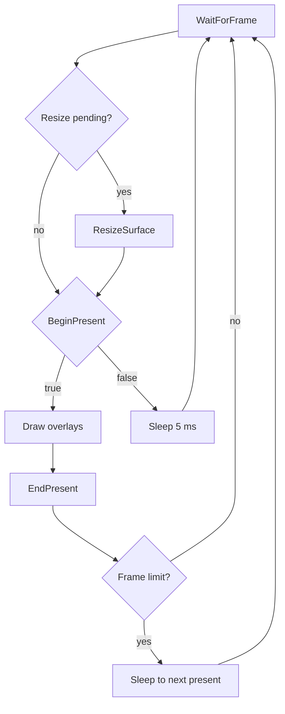

# Graphics

The Xbox 360 GPU, Xenos, runs command buffers that the game writes into guest memory. The commands are PM4 packets: register writes, draws, copies, fences and frame swaps. The game hands them to the GPU through the ring buffer, a circular buffer in guest memory whose read and write positions are GPU registers.

The SDK's graphics system runs those commands on a host graphics API and presents the frames in the window. `App::GetGraphics()` returns it as `IGraphicsSystem`, and the `rexgpu` system library provides it. See [System Libraries](../app/modules.md#system-libraries) for what `rexgpu` requires.

## Drivers

The graphics system does not draw. A graphics driver, an `IGraphicsDriver` in a separate driver module, does the work on the host GPU. A driver for the Xenos command stream is an `IXenosGraphicsDriver`, which adds the ring buffer, the register reads and writes, and the read pointer write back to `IGraphicsDriver`.

Each driver belongs to a graphics family, the GPU command set it runs. The SDK has one family, `xenos`. A program states the family it requires in `AppSysRequirements::graphics_family`:

- `TitleApp` requires `GraphicsFamily::kXenos`, because recompiled code writes Xenos commands.
- `App` requires `GraphicsFamily::kNone` by default, and then no graphics driver starts.

The `gpu.driver` setting selects the driver. The value `any` selects `d3d12` on Windows and `vulkan` elsewhere. See [Graphics Driver Values](../appendix/binaries-and-modules.md#graphics-driver-values) for every value and [Driver Modules](../appendix/binaries-and-modules.md#driver-modules) for the modules.

The driver is selected in two steps:

1. Before the systems start, the app loads the driver module of the family and the driver name, such as `rexgpu-xenos-vulkan` for `gpu.driver = vulkan`.
2. When the graphics system starts, it creates the driver of that name from the loaded modules.

In a program that requires `xenos`, startup fails when the selection finds no driver, or finds a driver that is not a Xenos driver. [`rexglue_configure_target`](../reference/cmake.md#staged-files) copies every built graphics driver module next to the executable, so each value of `gpu.driver` can load.

`gpu.d3d12.adapter` and `gpu.vulkan.device` choose the host GPU when the machine has more than one.

## Xenos Drivers

The three Xenos drivers, for Direct3D 12, Vulkan and no GPU, derive from `XenosGraphicsDriverBase` in the static library `rexgpu-xenos-base`. The base class holds what all three share:

- The register file of the GPU.
- The command processor, which reads the ring buffer and runs the PM4 packets on the `GPU Commands` thread.
- The `GPU VSync` thread.
- The `gpu.xenos.*` settings.
- The shader cache.

When a title attaches, the driver starts the `GPU Commands` and `GPU VSync` threads, and when it detaches, the driver stops them. The shader cache opens at attach for the title ID, under `app.cache_root`, when that setting is not empty and `gpu.xenos.store_shaders` is on. See [Shader Cache](../filesystem/folders-and-storage.md#shader-cache) for its files.

### Null Xenos Driver

`NullXenosGraphicsDriver`, selected with `gpu.driver = null`, runs the command stream with no host GPU. It executes fences, memory writes, register writes and interrupts, and skips draws, copies and swaps. It draws nothing, even when a window is open.

The null driver runs a game's GPU commands on a machine without a usable GPU. To run without a window as well, a program sets `ui.driver = none`. A `TitleApp` needs a window, so it fails startup with that setting.

## Without a Driver

In a program that requires no graphics family, the graphics system starts no driver. If such a program launches a game, the graphics system handles the GPU register accesses of the game:

- A register read returns the fixed value for the video mode, or else the last value written.
- After `EnableReadPointerWriteBack`, each write to the ring buffer write pointer is copied to the write back address, as if the GPU had read every command immediately.

No PM4 packet runs. A game that waits for a fence that a PM4 packet writes waits forever.

## Presenting

A driver presents frames through two objects. The provider holds the connection to the host GPU, and the presenter shows the finished frames in the window.

- With a window, the driver creates both in `SetSurface`, when the graphics system starts. If either cannot be created, graphics fails to start.
- Without a window, the driver creates only the provider, when a title attaches.

The graphics system makes the present calls of a driver from one thread, the present thread. The ring buffer and register calls of a Xenos driver come from guest threads. The present thread runs this loop:

`BeginPresent` returns false while the window is minimized or the surface is lost, and the loop then waits 5 ms before it tries again. The overlays are the UI system's debug, settings, achievements and console windows, which it draws on top of the frame. `gpu.frame_limit` sets the most presents per second, and 0 means no limit.

`IGraphicsSystem::GetFrameStats` returns `frame_time_ms` and `fps` over the last second, and `frame_count` since launch. A program that presents with its own renderer instead of a driver calls `IGraphicsSystem::ReportFrame` once per present, so these counts stay correct.

## MMIO Block

Recompiled code reaches the GPU registers through the MMIO block at `0x7FC80000`. `TitleRuntime::Launch` attaches the block, as `MMIOBlock::kGPU`, after the graphics system accepts the title. The block passes each access to the graphics system, which passes it to the driver. See [MMIO Blocks](../runtime/memory.md#mmio-blocks).

## Threads

| Thread | Started by | Runs |
|---|---|---|
| Present thread | `IGraphicsSystem` | The present calls and the overlays. |
| `GPU Commands` | A Xenos driver at title attach | The PM4 command stream. |
| `GPU VSync` | A Xenos driver at title attach | A vblank at the refresh rate of the video mode, or every millisecond when `gpu.vsync` is off. It can call into the game. |

The `GPU VSync` thread calls into the game because the game registers a graphics interrupt callback that runs at each vblank. See [Driver Context](driver-context.md#host-threads) for how a driver thread raises it, and [Startup Order](../app/app-lifecycle.md#startup-order) for when each step runs.
