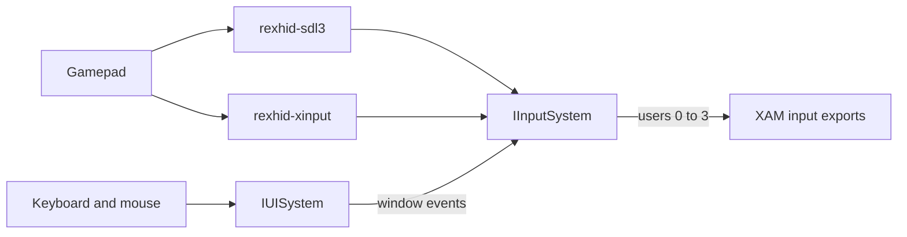

# Input

An Xbox 360 game reads controllers through the XAM input exports, such as `XamInputGetState`. It asks for one of four users, the controller slots 0 to 3 that the console assigns to connected controllers. The input system of the SDK maps host devices, such as gamepads, the keyboard and the mouse, to these four users.

`App::GetInput()` returns the input system as `IInputSystem`, and the `rexhid` system library provides it. Its calls are safe from any thread, except the calls that change a binding set, which must run on the UI thread.

## Drivers

An input driver reports the connected devices and their raw state. The input system merges the reports of all drivers, removes duplicates, assigns users and applies deadzones:



`hid.drivers` lists the input drivers in priority order, separated by commas. The default is `sdl3`. If a driver fails to load, the SDK logs a warning and starts the others. See [Driver Modules](../appendix/binaries-and-modules.md#driver-modules) for the input drivers.

- The SDL3 driver reads gamepads through SDL. A relative `hid.sdl.mappings_file` is relative to the executable folder. With an empty path, the driver loads no extra mappings file.
- The XInput driver runs on Windows and reports the guide button.

The keyboard and the mouse do not come from an input driver. The UI system receives them as window events and forwards them to the input system.

### Idle Pad

The idle pad is a virtual gamepad on user 0 that never presses anything. A game that waits at startup for a controller on user 0 then starts without one. It never counts as connected for [connection changes](#connection-changes).

## Users

A gamepad can appear in two drivers at once, such as an Xbox controller that both SDL and XInput report. The input system treats two reports as the same device when they share an XInput slot, or the same serial number, vendor and product. It then uses the copy from the driver listed first in `hid.drivers`.

The input system assigns users to devices in this order:

1. A device with XInput slot 0 to 3 takes the user of that number, if it is free.
2. Every other device takes the lowest free user.

A device keeps its user while it stays connected. A fifth device gets no user. With `hid.shared_pads` on, every device goes to user 0. The keyboard and mouse pad and the idle pad always go to user 0.

When several devices share a user, the input system merges their state:

- The buttons combine, so a button reads pressed when any device presses it.
- Each trigger and each stick axis takes the value with the larger magnitude.

### Deadzones

A worn stick reports small values when it rests at the center. `hid.left_stick_deadzone` and `hid.right_stick_deadzone` set a radial deadzone for each stick, as a fraction of the full stick range. The deadzone is a circle around the center. While the stick is inside the circle, both axes read 0. Values outside pass unchanged, without rescaling. The values 0 and 1 leave the stick unchanged. The SDK applies no other deadzone to the stick values.

## Keyboard and Mouse

The keyboard and mouse can stand in for a gamepad, or reach the game as a keyboard:

- With `hid.mnk_mode` on, the keyboard and mouse pad, a virtual gamepad on user 0, maps keys to buttons and sticks through the `hid.keybind_*` settings. `hid.mnk_mouse` moves the right stick with the mouse.
- With `hid.mnk_passthrough` on, the game gets a keyboard device that sends the raw keystrokes, even when `hid.mnk_mode` is on. User 0 then stays free for a gamepad.

The keyboard and mouse pad reads neutral while the window has no focus or an overlay holds the mouse. Gamepads keep reporting.

### Key Bindings

Each `hid.keybind_*` setting is a bind, a comma separated list of key chords, such as `Semicolon,Space` or `Shift+Up`. Any chord in the list presses the button.

- Key names are case sensitive.
- An empty value unbinds the button.
- If an item does not parse, the SDK logs a warning and the bind keeps its previous keys.
- The keyboard and mouse pad ignores gamepad and wheel items.

`IInputSystem::GetKeyBindings` returns the 25 keybind settings as one `rex::hid::IBindingSet`, which the settings overlay edits. See [hid](../reference/cvars.md#hid) in the settings reference for the list and the default keys.

### Pointer Mode

`IInputSystem::SetPointerMode` sets how the mouse pointer behaves in the window:

- `PointerMode::kFree`, the default, shows the pointer and lets it move freely.
- `kHidden` hides the pointer, for a game or overlay that draws its own.
- `kLocked` hides the pointer, keeps it in the window and reports motion as deltas.

The pointer is free while the window has no focus or the input system does not hold the input. The SDK applies the requested mode again when the window regains focus. With `hid.mnk_mode` and `hid.mnk_mouse` on, the pointer is locked while the window has focus.

## Window Events

The UI system forwards the keyboard, mouse, focus and resize events of the window to the input system. An open overlay or dialog can hold the keyboard or the mouse, and a key that triggers an overlay hotkey never reaches the input system. See [Events](ui.md#events) for the order in which the UI system delivers each event.

## XAM Input Exports

The game reads its users through the XAM input exports. See [XAM Input Exports](../appendix/xam-input-exports.md) for the result of each export.

### Connection Changes

On the console, the system notifies a game when a controller connects or disconnects. The runtime sends the notification `kXNotificationSystemInputDevicesChanged` to the game on each change.

Other code can watch the same changes. `IInputSystem::OnConnectionChange` registers a function that receives the user and whether a device is now connected, and returns a `ScopeGuard` that unregisters it when destroyed.

- The function runs on the thread that found the change, with no lock held.
- The input system finds a change when it reads the devices, which happens when the game or other code reads input, not when a device is plugged in.
- The keyboard and mouse pad counts as connected with `hid.mnk_mode` on, unless `hid.mnk_passthrough` is on as well.

### UI Block

While a XAM dialog, the console overlay or a prompt is open, the game must not react to the controller that the player uses for it. These call `IInputSystem::AcquireUIBlock` while they are open, and calls nest. During a block:

- A user with a device reads a neutral state, and a user without one reads as not connected.
- Vibration works.
- Buttons held when the block ends stay masked until they are released, so the press that closed the dialog does not reach the game.

## Reading Input from an App

App code that is not a game, such as an overlay or a tool, reads the keyboard and mouse from `IInputSystem`:

- `IsKeyDown` polls a key.
- `GetPointer` returns the pointer position, and `TakeMotion` and `TakeWheel` return the motion and wheel turns since the last call. The wheel counts whole detents and carries the remaining fraction to the next turn.
- `ParseVirtualKey`, `VirtualKeyToString`, `ParseInputSource`, `InputSourceToString`, `ParseKeyChord` and `FormatKeyChord` convert keys, inputs and chords to and from text.

`IInputSystem` cannot inject gamepad state. To add an input source, provide an input driver from your own module.

## Adding App Key Bindings

An app declares its own bindings with `IInputSystem::CreateBindingSet`, which returns a `rex::hid::IBindingSet` from `rex/hid/binding.h`. Each `BindingConfig` holds a name, the default inputs, a help text, a group and the stick it binds:

```cpp
static constexpr rex::hid::BindingConfig kBindings[] = {
    {"jump", "Space,PadA", "Jump", 1},
};
auto bindings = GetInput().CreateBindingSet(kBindings, "bind");
(void)bindings->Register(REX_SETTINGS());
```

- Each binding becomes a string setting named after the scope and the binding, here `bind.jump`. The settings overlay captures a key press for it.
- A stick binding holds up to eight key items, two for each direction. Each item fills the next key position, and an empty item keeps its place.
- Call `SetSource`, `SetSources`, `Clear`, `Reset` and `ResetGroup` on the UI thread.
- `FindConflict` finds another binding in the same group that uses an input.
- If any item of a bind text does not parse, the set rejects the whole text. `TakeParseErrors` returns a message for each bad item.
- `FindBySetting` returns the binding index for a setting name, such as `bind.jump`.
