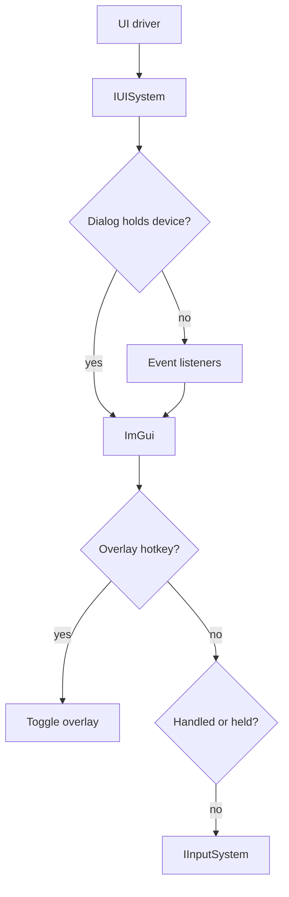

# UI

The UI system owns the window of the program. It opens the window, receives its keyboard, mouse and window events, draws the SDK overlays on top of each frame, and shows message boxes and prompts. The Xbox 360 had no window, so nothing in the game calls the UI system. It serves the program, the overlays and the XAM dialogs.

`App::GetUI()` returns the UI system as `IUISystem`, and the `rexui` system library provides it. The UI system runs on the UI thread, the thread that called `App::Init`.

## Drivers

The UI system draws nothing on its own and reaches the host through a UI driver, an `IUIDriver` in a module named after the driver, such as `rexui-sdl3`. A UI driver provides the native window, its events, the native message boxes and file dialogs, the list of displays, the host locales and the clipboard. It never draws. The graphics driver draws into the window, and ImGui draws the overlays.

`ui.driver` selects the UI driver. The SDK includes the SDL3 driver, `sdl3`, which adds the `ui.sdl.video_driver` setting. The value `none` starts no UI driver.

A program states whether it needs a window in `AppSysRequirements::ui`. `TitleApp` needs one, because the game draws into it. When a program needs a window and none opens, startup fails with a `kConfig` error. So `ui.driver = none` works only in a program that needs no window.

## Window

The `ui.*` settings set the window size, the fullscreen mode, the display and the aspect ratio. See [ui](../reference/cvars.md#ui) in the settings reference for the list.

The video mode is the display mode that the game reads, the resolution and refresh rate it renders for. The `ui.video_mode_*` settings set it and apply at the next start, because the game reads the mode once when it launches. While both video mode size settings keep their defaults, the video mode size follows `ui.resolution`, and then the window size.

### Headless

The UI system runs headless when no display is available. That happens in three cases:

- `ui.driver` is `none`.
- The UI driver reports no display, such as SDL3 with `ui.sdl.video_driver = dummy`, or when SDL cannot start its video subsystem.
- The window fails to open. The UI system logs a warning.

`IUISystem::IsHeadless` reports this state. While headless, `IUISystem::ShowMessage` only logs its message, `IUISystem::ShowChoice` and `IUISystem::ShowFileDialog` return an error, and the display list is empty. A prompt needs an open window, so without one every prompt is canceled immediately.

`ui.driver = none` changes one more thing. When a `TitleApp` fails to start before a window opens, it shows the error in a native message box and the crash reporter shows a dialog. With `none` in the config or on the command line, it shows neither. The protected `App::IsHeadlessRequested` reports this choice.

## Frame Loop

The UI thread runs the frame loop. `App::RunFrame` runs one pass. It runs the work posted with `IUISystem::PostTask`, waits up to 16 ms for window events, and delivers them. The default `App::OnRun` calls `RunFrame` until shutdown, and `TitleApp` runs the same loop while the game runs.

`IUISystem::RunSynchronous` runs a function on the UI thread and waits for it. Called on the UI thread, it runs the function immediately. After the UI system stops, it returns false and does not run the function.

A close request from the window calls `rex::app::RequestShutdown`. During shutdown, the UI thread keeps running posted work while it waits for the present thread and the guest threads to stop, so a thread that waits for the UI thread does not block the shutdown.

## Events

Code outside the input system receives window events through a listener. Implement `IUIEventListener` and add it with `IUISystem::AddEventListener`, which returns a `ScopeGuard` that removes it when destroyed.

- `OnUIEvent` receives the window events, such as resize, focus and close, as `UIEvent`.
- `OnInputEvent` receives the keyboard and mouse events as `InputEvent`.
- Setting `handled` on a key press or a character keeps it from the overlay hotkeys and the input system.
- Wheel events carry fractional detents in `scroll_x` and `scroll_y`.

A keyboard or mouse event from the UI driver takes this path:



1. An open overlay or dialog holds the keyboard or the mouse while ImGui wants that device, such as while a text field has focus. A press, character, motion or wheel turn on a held device skips the listeners.
2. ImGui receives every event, so the overlays can react to it.
3. A key press that matches an overlay hotkey toggles that overlay and goes no further.
4. The input system receives the event unless a dialog holds the device, or a listener handled a key press or a character. Key and button releases always reach it, so no key stays pressed.

A window event goes to the listeners first. The UI system then passes resize and focus changes to the input system, and focus changes to the audio system for `apu.mute_unfocused`. See [UI Block](input.md#ui-block) for how the console overlay and prompts hide the controllers from the game.

## Overlays and Dialogs

An overlay is an SDK window that ImGui draws on top of the game. A hotkey shows and hides it. The SDK has four:

| Overlay | Hotkey | Shows |
|---|---|---|
| Debug | F3 | Frame times and statistics |
| Settings | F4 | The settings, for editing |
| Achievements | F7 | The achievements of the game |
| Console | Backtick | The log, and a command line for settings and commands |

Each hotkey is a `ui.bind.*` setting, such as `ui.bind.console`. `IUISystem::ShowOverlay` and `IUISystem::ToggleOverlay` take an overlay name. Overlays and dialogs draw only when `IUISystem::DrawOverlays` runs. The graphics system calls it once per present, so a program with no graphics driver shows none unless its own renderer calls it.

### Adding an Overlay

Call `IUISystem::AddOverlays` from `OnInit`. It fails when no window is open or when a name is taken.

```cpp
static std::unique_ptr<rex::ui::IDialog> MakeStats(rex::ui::IUISystem& ui);

static constexpr rex::ui::OverlayConfig kOverlays[] = {
    {"stats", {rex::VirtualKey::kF9}, MakeStats},
};
(void)GetUI().AddOverlays(kOverlays);
```

- The factory function runs on the UI thread. Derive the overlay from `DialogBase` to implement only `Draw`.
- The name creates the hotkey setting, here `ui.bind.stats`. A chord of `kNone` registers no hotkey.

### Adding a Dialog

A dialog is an ImGui window without a hotkey. `IUISystem::AddDialog` has two forms:

- The form that takes a reference returns a `ScopeGuard` that removes the dialog. The dialog must outlive the guard.
- The form that takes a `std::unique_ptr` owns the dialog and destroys it when `Draw` returns false.

## Prompts and Messages

| Call | Behavior |
|---|---|
| `IUISystem::ShowMessage` | Logs a message and shows it in a native message box unless headless. |
| `IUISystem::ShowChoice` | Shows a native message box with buttons and returns the index of the button pressed. |
| `IUISystem::ShowFileDialog` | Shows the native open or save dialog and returns the chosen paths. |
| `IUISystem::ShowPrompt` | Shows an ImGui prompt in the window and calls back once, later, on the UI thread, with the answer. |
| `IUISystem::CancelPrompts` | Completes every open prompt as canceled. |

A prompt does not block the calling thread. See [Headless](#headless) for what these calls do without a display.
