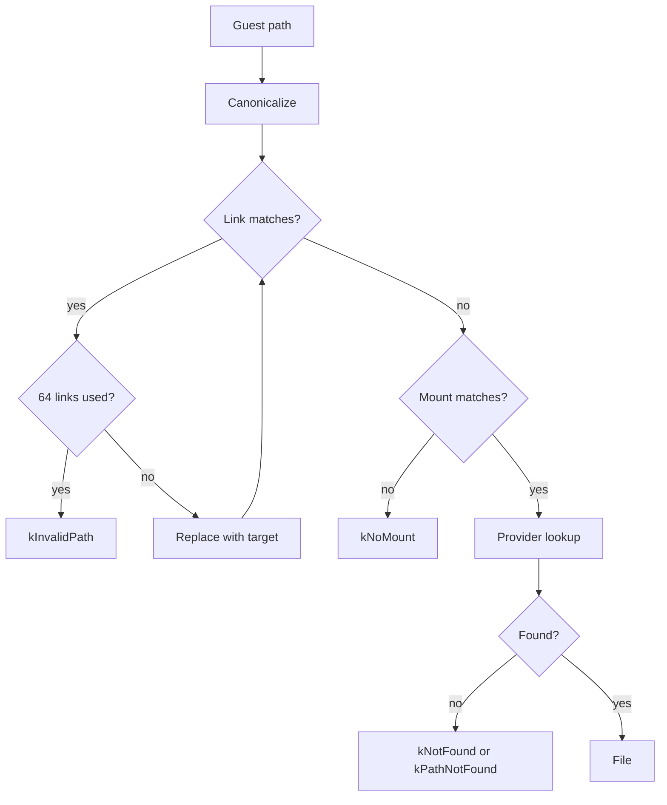
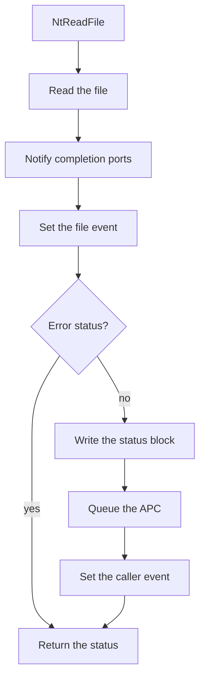

# Filesystem

A game opens its files by guest paths such as `game:\data\a.bin`. On the Xbox 360 these paths point to the disc, the hard disk or a content package. The SDK filesystem resolves each guest path to a host file, or to a file inside a container file such as a disc image.

Each `TitleRuntime` creates its own `rex::filesystem::IFileSystem` at `Load`, from the `rexfilesystem` system library. The kernel file exports, such as `NtCreateFile`, and the XAM content calls go through it. Failures are `FileSystemError` codes from `rex/filesystem/file_system_error.h`. See [Folders and Storage](folders-and-storage.md) for the settings that choose the host folders.

## Links and Mounts

The Xbox 360 kernel names each storage device with a device path, such as `\Device\Harddisk0\Partition1` for the game partition. Games rarely use device paths. They use short names such as `game:` and `update:`, which the kernel maps to device paths.

The filesystem keeps one table for each of these two steps:

- A link maps a short name to a device path. The link `game:` stands for `\Device\Harddisk0\Partition1`.
- A mount maps a device path to a provider, the object that serves the files under that path. The provider of the game partition reads the host folder in `title.game_root`.

So the link turns `game:\data\a.bin` into `\Device\Harddisk0\Partition1\data\a.bin`, and the mount turns that into the host file `data/a.bin` under `title.game_root`.

`IFileSystem::Link` adds a link, and `IFileSystem::Mount` adds a mount from a `MountEntry`. The entry holds the device path, the provider type, the host folder or container file, and the flags. A mount is read only unless its flags hold `MountFlags::kWritable`. `Mount` fails with:

- `kMountExists` when the path is mounted, compared ignoring case.
- `kNotFound` when the source does not exist.
- `kCorrupt` when the source is not the container type the entry gives.

## Providers

The provider type of a mount sets where its files come from:

| Type | Provider | Serves |
|---|---|---|
| `kHostDirectory` | `HostProvider` | A host folder. It writes to the folder when the mount is writable. |
| `kSTFS` | `ContainerProvider` | An STFS or SVOD package. It never writes. |
| `kDiscImage` | `ContainerProvider` | A GDFX disc image. It never writes. |
| `kNull` | `NullProvider` | Empty files at the paths that the entry lists in `null_paths`. |

`IFile::View` returns the contents of a file as a span of memory, without a copy. It works on host files and on container files that are stored in one contiguous extent. The null provider has no `View`.

### Host Directories

A host directory mount lists the folder when it is mounted, and checks the host folder again when a lookup finds no entry, so it finds files that were added after the mount. Names match ignoring case. A writable mount creates a missing folder, and a read only mount on a missing folder fails with `kNotFound`.

The provider refuses a name that contains a control character or any of `: < > " | ? * \ /`, because Windows cannot store those characters in a file name.

### Containers

The container provider reads three formats:

- STFS, the package format of downloaded content and saves.
- SVOD, the format of a disc installed to the hard disk.
- GDFX, the filesystem of an Xbox 360 disc image.

The `source` of a container mount can be the container file or a folder that holds one.

## Standard Mounts

When `title.game_root` is set, `TitleRuntime::Load` calls `IFileSystem::ConfigureStandardMounts`. The call clears every mount and link and adds these three mounts in order:

| Mount | Links | Contents |
|---|---|---|
| `\Device\Harddisk0\Partition1` | `game:` and `d:` | The folder in `title.game_root`. It is writable only when `title.game_writable` is true. |
| `\Device\Harddisk0\PartitionUpdate` | `update:` | The folder in `title.update_root`, read only. It is added only when that folder exists. |
| `\Device\Harddisk0` | None | A writable null mount with the empty files `\Partition0`, `\Cache0` and `\Cache1`. |

With an empty `title.game_root`, `Load` logs a warning and adds no mounts. A `title.game_root` that is not a folder fails `Load`. A failed update mount logs a warning, and `Load` continues without it.

`Load` reads `title.game_writable` once. Set it before `Load` runs, as a title layer value in `OnConfigure`. No link points at `cache:`, so a path under `cache:` fails with `kNoMount`.

A read only mount refuses to create files. An open for writing on a read only mount gets read access instead, and the filesystem logs a warning.

## Path Resolution

The filesystem resolves a guest path in these steps:

1. Canonicalizing removes `.` and `..` components. Either slash separates components. A `..` never removes a component that ends in a colon, so `game:\..` stays on `game:`.
2. The first link that is a prefix of the path is replaced with its target, and the search starts again on the new path. After 64 replacements the path fails with `kInvalidPath`, which ends a loop of links.
3. The first mount that is a prefix of the path receives the rest of the path. When two mount paths match, the mount added first wins.
4. The provider looks up the rest of the path. A missing last component fails with `kNotFound`. A missing folder before it, or a file where a folder belongs, fails with `kPathNotFound`.

Links and mounts match whole components and ignore ASCII case. So `game:` matches `game:\x` and `GAME:\x`, but not `game:x`.

## Opening a File

A game opens a file with the kernel export `NtCreateFile`. The export calls `IFileSystem::Open` and wraps the result in a `FileObject` from `rex/kernel/object/file_object.h`, the kernel object behind the guest file handle. `NtOpenFile` calls `NtCreateFile` to open an existing file.

The object attributes of the call can give an open directory handle as the root. The path is then relative to that directory, and the export calls `IFileSystem::OpenRelative`. Two open files on the same path share one node of the file tree.

### Disposition

The disposition of an open sets whether the open uses, creates, replaces or truncates the file, depending on whether the path exists. The open returns an `OpenAction` that says which of these it did. See [Dispositions](../appendix/file-exports.md#dispositions) and [Open Actions](../appendix/file-exports.md#open-actions) for each value.

Two `OpenOptions` fields select the type of entry:

- `create_directory` creates a directory instead of a file.
- `require_file` fails the open with `kIsDirectory` when the path is a directory.

See [Open Status Codes](../appendix/file-exports.md#open-status-codes) for the status that each failure returns to the game.

### Allocation Size

A file entry reports its `size` and its `allocation_size`, the space it takes on the device. The allocation size is `size` rounded up to the unit of the device:

- 512 bytes (`kBytesPerSector`) for host folders and GDFX images.
- 4 KiB blocks for STFS and SVOD packages.

### Directory Listing

`IFileSystem::List` walks the children of a directory and filters them with a wildcard pattern. Patterns follow the Windows NT rules and ignore case. They accept the DOS wildcards `<`, `>` and `"`, and `*.*` matches every name.

## IO Completion

On the console a read or write can finish after the call returns. The game then gets the result through the IO status block, a guest structure that receives the status and the byte count, through an event that it waits on, or through an APC, a function queued to run on its thread.

The SDK runs every read and write on the calling thread and finishes it before the export returns. `NtReadFile` runs these steps:

After every read, failed or not, the file object notifies the IO completion ports that the file is bound to and sets its own event. Only when the status is not an error does the export write the status block, queue the APC and set the event that the caller passed, each when the caller passed one. End of file is an error status, so a read at the end of a file returns `X_STATUS_END_OF_FILE` and leaves the status block unchanged. `NtWriteFile` runs the same steps.

XAM operations that report into an `XOVERLAPPED` block complete through the [dispatcher](../runtime/kernel.md#dispatcher) instead.

## Extract a Container

[`rexglue vfs dump`](../reference/cli.md#vfs-dump) extracts the files of a container to a host folder.
