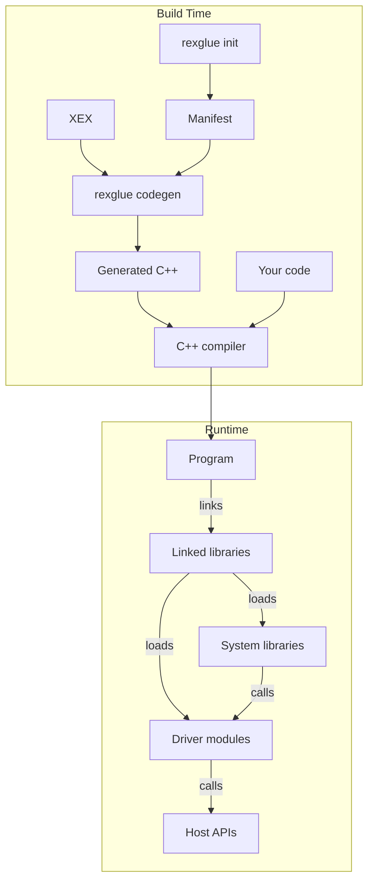
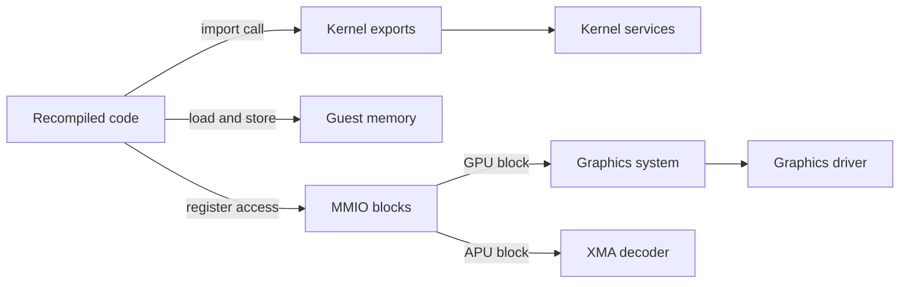

# ReXGlue SDK

ReXGlue is an experimental toolset for studying Xbox 360 software and hardware. It recompiles the PowerPC code of an Xbox 360 executable, the XEX, into C++ and compiles that C++ into a native PC program. The program runs against the SDK libraries, which take the place of the console's kernel, system software and devices.

!!! note "Purpose"
    ReXGlue is for education and research. It is not a tool for porting, cloning or redistributing existing games. The SDK contains no game code or data. Use it only with executables you have the right to use.

The `rexglue` tool and CMake turn the XEX into a native program, which runs the game on the SDK libraries.

## Build Time

The SDK's `rexglue` command line tool builds a program in two steps:

- `rexglue init` creates a project. It writes the project manifest, a TOML file with the path of the XEX and the settings for recompiling it. Next to the manifest it writes the CMake files and a `src/main.cpp` with a `TitleApp` subclass.
- `rexglue codegen` reads the XEX and the manifest and writes the generated C++, with one C++ function for each PowerPC function it finds.

You build the project with CMake. The build runs `rexglue codegen` as a step before it compiles, and runs it again when an input changes. The C++ compiler then compiles the generated C++ together with your own code, such as hooks, into one executable that links the SDK. Each DLL module that the manifest lists becomes a shared library next to the executable.

`rexglue` is a separate program. The build runs it, and the program it builds never links or loads it.

See [Getting Started](getting-started.md) for the commands and [Codegen Pipeline](codegen/codegen-pipeline.md) for what codegen does.

## Runtime

The program links the SDK through the `rex::sdk` CMake target. These are the linked libraries:

- `rexbase` provides settings, logging, the platform layer and `rex::Init`, which loads the other libraries.
- `rexppc` provides `PPCContext`, the guest register state that every recompiled function receives, and the routing of hardware register accesses.
- `rexxenos` holds the register, format and texture layout definitions of the Xenos GPU. It is a static library.
- `rexkernel` provides the kernel exports, guest memory and `TitleRuntime`, which loads and runs the game.
- `rexxam` provides the XAM exports.
- `rexxbdm` provides the XBDM exports.
- `rexapp` provides `App` and `TitleApp`, the base classes of the program.

A kernel export is a host function that takes the place of a function the XEX imports from the Xbox 360 kernel, XAM or XBDM. Guest memory is the 32 bit address space of the console, mapped into the host process.

At startup `App::Init` calls `rex::Init`, which loads the system libraries by name. The program never links them.

| Library | Provides |
|---|---|
| `rexfilesystem` | The filesystem that the game files are mounted in |
| `rexhid` | `IInputSystem`, for input |
| `rexapu` | `IAudioSystem`, for audio |
| `rexui` | `IUISystem`, for the window and the UI |
| `rexgpu` | `IGraphicsSystem`, for graphics |

`rexkernel`, `rexxam` and `rexxbdm` load as modules in the same step. The settings of each system select its drivers, and `rex::Init` loads the driver modules that provide them, such as `rexgpu-xenos-vulkan` for Vulkan graphics. The systems call the drivers, and the drivers call host APIs such as Direct3D 12, Vulkan, SDL3 and XInput.

`TitleApp` runs the game. `TitleRuntime::Load` maps guest memory, reads the image and mounts the game files. `TitleRuntime::Launch` attaches the game to the four systems and starts its main thread.

See [Binaries and Modules](appendix/binaries-and-modules.md) for every library and driver module.

## How Recompiled Code Reaches the Host

Recompiled code reaches the host in three ways:

- A call to an imported function is a call to the kernel export of the same name with an `__imp__` prefix. A call to `NtCreateFile` becomes a call to `__imp__NtCreateFile`. The exports run on the kernel services, the threads, objects, files and memory that the runtime provides.
- A load or store reads or writes guest memory through `base`, the host pointer to guest memory that every recompiled function receives.
- A read or write of a hardware register goes to one of two MMIO blocks. The runtime routes the GPU block to the graphics system, which passes the register to the graphics driver. The XMA decoder handles the APU block.

## Where to Go Next

- [Getting Started](getting-started.md): install the tools, build the SDK and run a first project.
- [Code Generation](codegen/codegen-pipeline.md): how `rexglue codegen` turns the XEX into C++.
- [App](app/app-lifecycle.md): the `App` class, modules, settings and logging.
- [Runtime](runtime/lifecycle.md): how `TitleRuntime` loads and runs the game, guest memory and the kernel services.
- [Filesystem](filesystem/filesystem.md): how guest paths reach host files.
- [Devices](devices/graphics.md): the graphics, audio, input and UI systems and their drivers.
- [Reference](reference/cli.md): the command line, the manifest, CMake and the API.
- [Appendix](appendix/binaries-and-modules.md): the long tables, starting with the libraries and driver modules.

The [Glossary](reference/glossary.md) explains guest, host, title and the other SDK terms.
