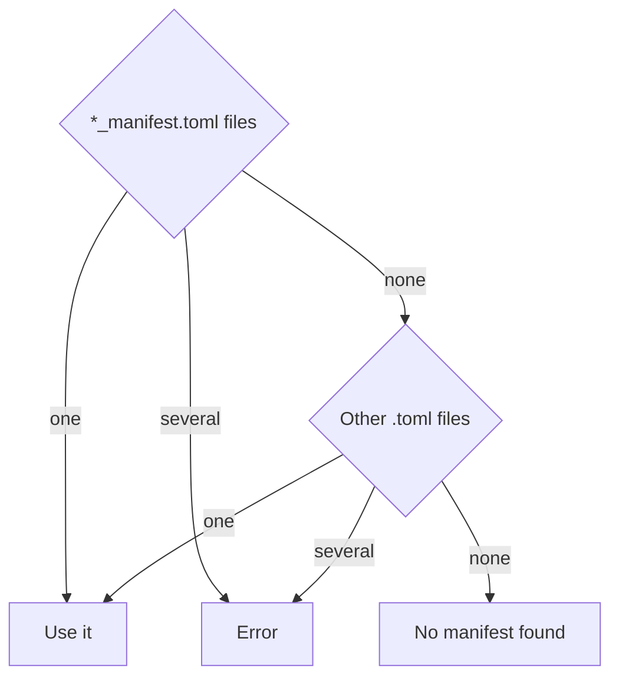

# Command Line

`rexglue` is the SDK's command line tool. It creates projects, recompiles their XEX files into C++, and has a few commands for working with game files. The SDK install puts it in the `bin` folder (see [Getting Started](../getting-started.md#build-and-install-the-sdk)). This page lists every command with its options and defaults.

```
rexglue [global options] <command> [options]
```

| Command | Purpose |
|---|---|
| [`codegen`](#codegen) | Writes the C++ for a project. The project build runs it. |
| [`init`](#init) | Creates a project from an entrypoint XEX. |
| [`init module`](#init-module) | Adds a DLL module to a project. |
| [`init achievements`](#init-achievements) | Writes the achievements of a XEX to a TOML file. |
| [`list shim`](#list-shim) | Lists the routines that the `[shim]` table accepts. |
| [`vfs dump`](#vfs-dump) | Extracts a container file to a folder. |
| [`recompile-tests`](#recompile-tests) | Writes recompiler tests from PowerPC test programs. |

## Global Options

Global options go before or after the command name.

| Option | Meaning |
|---|---|
| `--version` | Prints the SDK version and exits. |
| `--log-level LEVEL` | Sets the log level to `trace`, `dev`, `debug`, `info`, `warn`, `error`, `critical` or `off`, ignoring case. Any other value fails before the command runs, unless `--verbose` is also passed. The default is `info`. See [Logging](../app/logging.md). |
| `--log-file PATH` | Appends the log to this file in addition to the terminal. |
| `-v`, `--verbose` | Sets the level to `trace`. Overrides `--log-level`. |
| `-f`, `--force` | Overrides the checks of `init` and `codegen`, as listed below. |

With `init`, `--force` replaces an existing `CMakeLists.txt`, `CMakePresets.json` and manifest. With `codegen`, it skips the stamp check, and writes the output even when validation fails, with the validation errors logged as warnings.

- Color is off when stderr is not a terminal or when `NO_COLOR` is set.
- The exit code is 0 on success and 1 on failure.

## `codegen`

Writes the C++ for the binaries that a [project manifest](manifest.md) lists. See [Codegen Pipeline](../codegen/codegen-pipeline.md) for what it does.

```
rexglue codegen [config] [options]
```

| Argument | Meaning |
|---|---|
| `config` | Points to the manifest file. If it is omitted, codegen searches (see [Finding the manifest](#finding-the-manifest)). |
| `--target NAME` | Processes this DLL module. Can be repeated. The entrypoint is always processed. |
| `--ignore-stamp` | Regenerates even when the inputs match the stamp from the last run. |

### Finding the Manifest

Without `config`, codegen looks in the current folder only. A file whose name ends in `_manifest.toml` comes first, and any other `.toml` file is a fallback:



- With several candidates, codegen fails and asks for the manifest path.
- With no `.toml` file, codegen fails with `No manifest .toml found`.
- The chosen file must have a `[project]` table.

### Targets

`--target` selects a DLL module by its target name. The target name is the file name of the module without its extension, with each `.` and space replaced by `_`, in its original case. Two targeted binaries cannot write to the same `out_directory_path`.

### Limits

The limits bound the analysis passes and the size of the output files. Changing a limit makes the next run regenerate every binary. The project build passes `--max_file_size_bytes` from the CMake variable `REXGLUE_RECOMP_MAX_FILE_SIZE`.

| Option | Default | Range | Meaning |
|---|---|---|---|
| `--max_discovery_iterations` | 1000 | 1 to 100000 | Discovery passes. |
| `--max_vtable_iterations` | 100 | 1 to 100000 | Vtable resolution passes. |
| `--max_resolve_iterations` | 100 | 1 to 100000 | Merge resolution passes. |
| `--backward_scan_limit` | 64 | 1 to 10000 | Instructions scanned backward to find a jump table base. |
| `--max_jump_table_entries` | 512 | 1 to 100000 | Jump table entries accepted. |
| `--max_file_size_bytes` | 1048576 | 65536 to 67108864 | Largest generated source file in bytes. |
| `--max_eh_states` | 100 | 1 to 100000 | C++ exception states per function. |
| `--max_eh_try_blocks` | 50 | 1 to 100000 | C++ try blocks per function. |
| `--max_eh_ip_map_entries` | 200 | 1 to 100000 | C++ IP map entries per function. |
| `--max_seh_scope_entries` | 100 | 1 to 100000 | SEH scope entries per function. |

### Steps

1. Skips each binary whose manifest settings, input files, limits and SDK version are unchanged since the last run, and whose generated files all exist. `--ignore-stamp` and `--force` turn off the skip.
2. Analyzes each binary that is not skipped. If validation fails, codegen stops before it writes any generated file, unless `--force` is passed.
3. Writes the files of each analyzed binary. A file whose content is unchanged keeps its time stamp. Codegen removes the generated files that the run no longer writes.
4. Writes `codegen.stamp` in each output folder, and `codegen.d` and `codegen.build.stamp` in the entrypoint folder.
5. Scans the `src` folder next to the manifest, and lists each file and line that includes a header that this run removed.
6. Writes the SDK version into `[project].sdk_version` and logs a summary, such as:

    ```
    Codegen summary: 12 written, 3 unchanged, 0 deleted, 1 module(s) up to date
    ```

## `init`

Creates a project from an entrypoint XEX.

```
rexglue init --project-name NAME --xex-path PATH [options]
```

| Option | Meaning |
|---|---|
| `--project-name NAME` | Required. Sets `[project].name`. The name starts with a letter and contains only letters, digits and `_`. |
| `--xex-path PATH` | Required. Points to the entrypoint XEX, which must be inside the game root. |
| `--game-root PATH` | Sets the game assets folder. The default is the XEX folder. |
| `--project-root PATH` | Sets the folder to create the project in. The default is the current directory. |
| `--scan-dll` | Scans the game root and its subfolders for `.dll` files and adds each one as a `[[modules]]` entry. |
| `--template-dir PATH` | Points to a folder of templates that replace the built in templates. |

`init` writes these files, shown for the project name `foobar`:

| File | When it is written |
|---|---|
| `CMakeLists.txt` | Replaced only with `--force`. |
| `CMakePresets.json` | Replaced only with `--force`. |
| `foobar_manifest.toml` | Replaced only with `--force`. |
| `src/main.cpp` | Written once and never replaced. |
| `src/foobar_hooks.cpp` | Written once and never replaced. |

If `CMakeLists.txt`, `CMakePresets.json` or the manifest exists and `--force` is not passed, `init` lists those files and writes nothing.

- `CMakePresets.json` defines the configure presets `win-amd64`, `win-arm64`, `linux-amd64`, `linux-arm64`, `mac-amd64` and `mac-arm64`.
- Each configure preset has `-debug`, `-release` and `-relwithdebinfo` build presets.

When `rexglue` runs from an installed SDK, the presets set `CMAKE_PREFIX_PATH` to the install folder, so that CMake finds the SDK package. When `rexglue` runs from a build inside the SDK source tree, the presets set `REXSDK_DIR` to the source folder, so that the project builds the SDK from source. See [SDK Discovery](cmake.md#sdk-discovery).

## `init module`

Adds a DLL module to an existing manifest.

```
rexglue init module --project-root PATH --xex-path PATH --guest-path PATH
```

| Option | Meaning |
|---|---|
| `--project-root PATH` | Required. Points to the project folder that contains the manifest. |
| `--xex-path PATH` | Required. Points to the DLL file. |
| `--guest-path PATH` | Required. Sets the path that guest code passes when it loads the module. |

The project root must contain a manifest. The command appends a `[[modules]]` entry with `guest_path`, `file_path`, `out_directory_path` and `includes = []`.

- The output folder is `generated/` and the module name. The module name is the DLL file name without its extension, in lower case, with each `.` and space replaced by `_`.
- The guest path must be unique (see [Files and Identity](manifest.md#files-and-identity)).
- If an entry with the same `file_path` or `guest_path` exists, nothing changes.
- `rexglue init --template-dir PATH module ...` applies the template folder to the module entry.

## `init achievements`

Reads the achievements that a XEX holds in its resources, and writes them with their icons.

```
rexglue init achievements <xex_path> [output_dir] [--language ID]
```

| Argument | Meaning |
|---|---|
| `xex_path` | Points to the XEX to read. |
| `output_dir` | Sets the output folder. The default is the XEX folder. |
| `--language ID` | Selects the language of the strings. The default is `1`. |

An ID that is not in the table, or a language that the XEX has no strings for, falls back to the default language of the XEX. The table has no ID 10.

| ID | Language |
|---|---|
| 1 | English |
| 2 | Japanese |
| 3 | German |
| 4 | French |
| 5 | Spanish |
| 6 | Italian |
| 7 | Korean |
| 8 | Traditional Chinese |
| 9 | Portuguese |
| 11 | Polish |
| 12 | Russian |
| 13 | Swedish |
| 14 | Turkish |
| 15 | Norwegian |
| 16 | Dutch |
| 17 | Simplified Chinese |

The command writes `achievements.toml` with one `[[achievements]]` table per achievement.

| Key | Meaning |
|---|---|
| `id` | Gives the achievement ID. |
| `label` | Gives the name. |
| `description` | Gives the description. |
| `unachieved_description` | Gives the description shown while the achievement is locked. |
| `gamerscore` | Gives the score the achievement awards. |
| `image_id` | Gives the icon ID. |
| `icon_path` | Gives the icon file path, `icons/<image_id>.png`. |
| `flags` | Gives the flag bits. |

The icons go to `icons/`, with the game icon as `icons/title.png`. Existing files are overwritten.

## `list shim`

Prints the names of the library routines that the [`[shim]` table](manifest.md#shim) accepts, with their groups. See [Shims](../runtime/shims.md) for what each group does.

```
rexglue list shim [--group NAME] [--json]
```

| Option | Meaning |
|---|---|
| `--group NAME` | Lists one group only. |
| `--json` | Prints an array of objects with `name`, `group`, `stub`, `requires_heap` and `description`. |

## `vfs dump`

Extracts an STFS, SVOD or GDFX container file to a folder.

```
rexglue vfs dump <source> <destination>
```

| Argument | Meaning |
|---|---|
| `source` | Points to an STFS, SVOD or GDFX container file, or a folder that contains one. |
| `destination` | Points to the folder to extract into. |

Before it extracts, the command prints the container type, the node count and the total size in bytes.

## `recompile-tests`

Recompiles PowerPC test programs and writes Catch2 tests that compare registers and memory with the expected values from the assembly source. The command is for developers of the recompiler.

```
rexglue recompile-tests --bin-dir PATH --asm-dir PATH --output PATH [--case-files N]
```

| Option | Meaning |
|---|---|
| `--bin-dir PATH` | Required. Points to a folder of linked `.bin` files, each with a `.map` file of the same name. |
| `--asm-dir PATH` | Required. Points to a folder of `.s` sources that contain the test directives. |
| `--output PATH` | Required. Points to the output folder. |
| `--case-files N` | Splits the test cases over this many files, `ppc_test_cases_0.cpp` to `ppc_test_cases_7.cpp` for 8, so they compile in parallel. The default is 1. |

- It writes `ppc_config.h`, `ppc_test_decls.h`, `ppc_test_functions.cpp` and the case files, `ppc_test_cases_0.cpp` and up.
- It sets every `[vector_math]` key to `exact` and turns on `forward_stack_stores`.
- A test directive is a comment line after a label, one of `#_REGISTER_IN`, `#_MEMORY_IN`, `#_REGISTER_OUT` and `#_MEMORY_OUT`.
- A `.bin` file without a matching `.s` file logs a warning and produces no tests.

The command fails when a map file has no symbols or a label that starts with `test_` has no emitted function.
