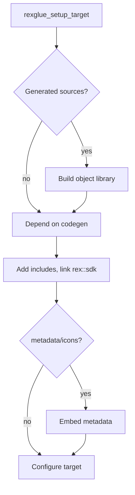

# CMake

A project builds with CMake. This page lists the CMake functions, cache variables, presets and options of the SDK. The examples use the project `foobar` from [Getting Started](../getting-started.md).

The functions come from two places:

- The SDK package defines most of them. They are available after `find_package(rexglue CONFIG REQUIRED)`, or after `add_subdirectory` of the SDK source.
- `generated/rexglue.cmake`, which `rexglue init` writes into the project, defines the [scaffold functions](#scaffold-functions). It finds the SDK and creates the codegen target, and the project's `CMakeLists.txt` includes it.

A host executable is the native program that a project builds. It links the SDK and the recompiled code, and loads the SDK modules at runtime.

## Host Executable

### `rexglue_setup_target`

```
rexglue_setup_target(<target> [NO_COPY] [EXCLUDE <name>...])
```

Defined in `generated/rexglue.cmake`. Adds the generated sources of the entrypoint to the target, then calls `rexglue_configure_target` with the other arguments. The project's `CMakeLists.txt` calls it on the executable.



- The generated sources build into the object library `foobar_recompiled`, which the target links.
- The include paths are the project root, `src` and the entrypoint output folder.
- If a `metadata/icons` folder exists, it is embedded with the prefix `icons`.

### `rexglue_configure_target`

```
rexglue_configure_target(<target> [NO_COPY] [EXCLUDE <name>...])
```

Makes an executable a host executable. It applies the compile settings, links the host allocator, and after each build copies the runtime files next to the executable. The runtime files are the SDK libraries, modules and third party libraries that the program loads, listed under [Staged Files](#staged-files).

| Argument | Meaning |
|---|---|
| `<target>` | The host executable target. |
| `NO_COPY` | Copies no runtime files. Cannot be combined with `EXCLUDE`. |
| `EXCLUDE` | Leaves the listed [staged files](#staged-files) out of the copy. A name is a module or driver module target such as `rexhid-xinput`, a linked SDK library such as `rexbase`, or `SDL3`. |

- Defines `REXGLUE_BUILD_CONFIG` as the build configuration.
- On Linux and macOS, the run path is the executable folder and the install library folder.
- On Windows, exports the symbols that select the discrete GPU on hybrid graphics systems.
- Any other argument is a configure error.

#### Staged Files

- `rexbase` (with ImGui), `rexppc`, `rexkernel`, `rexapp`, and `TracyClient` when that target exists.
- `rexfilesystem`, `rexhid`, `rexapu`, `rexui`, `rexgpu`, `rexxam` and `rexxbdm`.
- `rexgpu-xenos-null`, `rexgpu-xenos-vulkan`, `rexapu-sdl3`, `rexhid-sdl3` and `rexui-sdl3`, plus `rexgpu-xenos-d3d12` and `rexhid-xinput` on Windows.
- SDL3, under its soname on Linux and macOS, such as `libSDL3.so.0`.
- On macOS, the Vulkan loader and MoltenVK with its ICD file, in a `vulkan` folder.
- On Windows, the runtime DLLs and the PDB files of the staged libraries.

### `rexglue_get_runtime_files`

```
rexglue_get_runtime_files(<host_target> <out_var>)
```

Sets `out_var` to the libraries, modules and SDL3 that `rexglue_configure_target` stages, as absolute paths in the host folder. Call it after `rexglue_configure_target`.

- Leaves out the Windows runtime DLLs and PDBs, the macOS `vulkan` folder and libraries the host links on its own.
- Entries can be generator expressions, so use the list only where CMake accepts them, such as `install(FILES)` and `file(GENERATE)`.

```cmake
rexglue_configure_target(mygame)
rexglue_get_runtime_files(mygame mygame_runtime_files)
install(FILES ${mygame_runtime_files} TYPE BIN)
```

## DLL Modules

### `rexglue_configure_module_target`

```
rexglue_configure_module_target(<target> [HOST <host_target>])
```

Applies the compile settings and the host allocator to the shared library of a DLL module, and on Linux sets the run path. The `dll_targets.cmake` that codegen writes calls it for each DLL module.

| Argument | Meaning |
|---|---|
| `<target>` | The module library target. |
| `HOST` | The host target. The module builds into the host folder, and the host depends on the module. The host can be declared after the module. |

- Without `HOST`, the output goes to `CMAKE_RUNTIME_OUTPUT_DIRECTORY` when set.
- The host stages the runtime files.

## Build Steps

### `rexglue_add_codegen`

```
rexglue_add_codegen(<target> MANIFEST <file> OUTPUT_DIR <folder> WORKING_DIRECTORY <folder>
                    TOOL <command...> [MAX_FILE_SIZE <bytes>] [SOURCES <file>...])
```

Defines a custom target that runs `rexglue codegen`. `generated/rexglue.cmake` calls it to create `foobar_codegen`.

- The target reruns when an input in `codegen.d` or `MAX_FILE_SIZE` changes.
- The target writes `sources.cmake`, a configure dependency, so a changed source list regenerates the build files.

| Argument | Meaning |
|---|---|
| `<target>` | The custom target. |
| `MANIFEST` | Points to the [project manifest](manifest.md). |
| `OUTPUT_DIR` | Points to the entrypoint output folder, which contains `codegen.build.stamp`, `sources.cmake` and `codegen.d`. |
| `WORKING_DIRECTORY` | Sets the folder the tool runs in. |
| `TOOL` | Gives the command that runs the tool, such as `$<TARGET_FILE:rex::rexglue>`. |
| `MAX_FILE_SIZE` | Passed as `--max_file_size_bytes`. |
| `SOURCES` | Lists the generated files as outputs of the step. |

### `rexglue_embed_metadata`

```
rexglue_embed_metadata(<target> DIRECTORY <folder> [PREFIX <prefix>])
```

Embeds the files under a folder into the executable. With `DIRECTORY metadata/icons` and `PREFIX icons`, the path `icons/foo.png` resolves at runtime.

| Argument | Meaning |
|---|---|
| `<target>` | The target that receives the files. |
| `DIRECTORY` | Required. Points to the folder to embed. |
| `PREFIX` | Adds a prefix to the asset paths. |

## Compile Settings

The configure functions and the scaffold call these. Call them only for other targets.

### `rexglue_apply_target_settings`

```
rexglue_apply_target_settings(<target>)
```

Applies the CPU flags that the SDK and the generated code need:

- `-msse4.1` on x86_64
- `-mcmodel=large` and the `--no-relax` link option on Linux x86_64
- `-march=armv8-a` on Linux aarch64

`rexglue_cpu_flags(<out_var>)` returns the compile flags as a list.

### `rexglue_link_host_allocator`

```
rexglue_link_host_allocator(<target>)
```

Adds the `operator new` and `operator delete` forwarders to an executable or a shared library, so that one binary can free memory that another binary allocated.

- Static libraries are skipped.
- `generated/rexglue.cmake` does not call it.

### `rexglue_set_rpath`

```
rexglue_set_rpath(<target> <origin>)
```

Sets the run path to the target's folder and the install library folder. `<origin>` is `$ORIGIN` on Linux and `@executable_path` on macOS.

### `rexglue_recomp_options`

```
rexglue_recomp_options(<options_var> <optimized_var>)
```

Computes the recompiled code options for every configuration, each wrapped in `$<CONFIG:...>`.

| Argument | Meaning |
|---|---|
| `<options_var>` | Receives the options. |
| `<optimized_var>` | Receives `ON` when any configuration sets an optimization level. |

- It declares the [cache variables](#cache-variables).
- The options always include `-fasync-exceptions` on Windows and `-fasynchronous-unwind-tables` elsewhere.

## Scaffold Functions

These are defined in `generated/rexglue.cmake`. `rexglue codegen` rewrites the file when it differs from the SDK template, so edits to it do not last.

### `rexglue_setup_host_library`

```
rexglue_setup_host_library(<library>)
```

Applies the SDK settings, the include paths and the codegen dependency to a library that compiles against the SDK, and links it to `rex::sdk`. The project's `CMakeLists.txt` calls it on the hooks library `foobar_common`.

`rex::sdk` is the one target a project links. It collects `rex::base`, `rex::ppc`, `rex::xenos`, `rex::kernel`, `rex::xam` and `rex::app`.

### `rexglue_apply_recomp_settings`

```
rexglue_apply_recomp_settings(<target> <pch_header>)
```

Applies the precompiled header and the recompile options to a target.

### Other Contents

- Calls `rexglue_add_codegen` for `foobar_codegen`.
- Includes `dll_targets.cmake` when codegen has written it.
- `REXGLUE_HOST_TARGET` selects the executable that DLL modules build next to. The default is `PROJECT_NAME`. If the executable has another name, set the variable before the file is included.

### SDK Discovery

`generated/rexglue.cmake` finds the SDK in one of two ways:

- When the cache variable `REXSDK_DIR` points to an SDK source folder, such as a submodule, it adds that folder with `add_subdirectory` and builds the SDK with the project.
- Otherwise it finds an installed SDK with `find_package(rexglue)`, which searches `CMAKE_PREFIX_PATH`.

`rexglue init` sets one of the two in the presets it writes. From an installed SDK it sets `CMAKE_PREFIX_PATH` to the install folder, and from a build inside the SDK source tree it sets `REXSDK_DIR`.

`REXSDK_VERSION` pins the exact SDK version of an installed SDK. Without it, `find_package` accepts the version that last wrote `generated/rexglue.cmake` or a newer one with the same major version.

## Cache Variables

These cache variables apply to the recompiled sources only, not to your own code.

| Variable | Meaning |
|---|---|
| `REXGLUE_RECOMP_OPTIMIZATION` | Sets the optimization level to empty, `O0`, `O1`, `O2` or `O3`. |
| `REXGLUE_RECOMP_DEBUG_INFO` | Sets the debug info level to empty, `line-tables-only`, `full` or `none`. |
| `REXGLUE_RECOMP_MAX_FILE_SIZE` | Sets the largest generated source file in bytes. Empty uses the tool default. See [Limits](cli.md#limits). |

### Per Configuration Variables

A variable with a configuration suffix overrides the plain variable for that configuration.

| Variable | Meaning |
|---|---|
| `REXGLUE_RECOMP_OPTIMIZATION_DEBUG`, `REXGLUE_RECOMP_OPTIMIZATION_RELEASE`, `REXGLUE_RECOMP_OPTIMIZATION_RELWITHDEBINFO` | Set the optimization level of one configuration. |
| `REXGLUE_RECOMP_DEBUG_INFO_DEBUG`, `REXGLUE_RECOMP_DEBUG_INFO_RELEASE`, `REXGLUE_RECOMP_DEBUG_INFO_RELWITHDEBINFO` | Set the debug info level of one configuration. |

### Defaults

| Configuration | Optimization | Debug info |
|---|---|---|
| Debug | `O1` | `line-tables-only` |
| Release | Uses the CMake build type flags | `none` |
| RelWithDebInfo | Uses the CMake build type flags | `line-tables-only` |

## Presets

`CMakePresets.json` in the SDK root defines these configure presets. Each one builds into `out/build` and installs into `out/install`, in a folder named after the preset, such as `out/install/linux-amd64`. A preset is available only on its host system. The project presets that `rexglue init` writes have the same names, except `linux-amd64-tsan`.

| Configure preset | Host | Build presets |
|---|---|---|
| `win-amd64` | Windows | `win-amd64-debug`, `win-amd64-release`, `win-amd64-relwithdebinfo` |
| `win-arm64` | Windows | `win-arm64-debug`, `win-arm64-release`, `win-arm64-relwithdebinfo` |
| `linux-amd64` | Linux | `linux-amd64-debug`, `linux-amd64-release`, `linux-amd64-relwithdebinfo` |
| `linux-amd64-tsan` | Linux | `linux-amd64-tsan` (Debug only) |
| `linux-arm64` | Linux | `linux-arm64-debug`, `linux-arm64-release`, `linux-arm64-relwithdebinfo` |
| `mac-amd64` | macOS | `mac-amd64-debug`, `mac-amd64-release`, `mac-amd64-relwithdebinfo` |
| `mac-arm64` | macOS | `mac-arm64-debug`, `mac-arm64-release`, `mac-arm64-relwithdebinfo` |

- `linux-amd64-tsan` is `linux-amd64` with `REXGLUE_ENABLE_TSAN` on.
- Each build preset has a test preset with the same name.

## SDK Build Options

| Option | Default | Meaning |
|---|---|---|
| `REXGLUE_BUILD_TESTS` | `ON` when the SDK is the top level project | Builds the unit tests. |
| `REXGLUE_BUILD_PPC_TESTS` | `OFF` | Builds the PPC instruction tests, which require the PPC toolchain. |
| `REXGLUE_REGISTER_PACKAGE` | `OFF` | Registers the install prefix in the CMake user package registry. |
| `REXGLUE_ENABLE_SANITIZERS` | `OFF` | Builds with UndefinedBehaviorSanitizer. |
| `REXGLUE_ENABLE_TSAN` | `OFF` | Builds with ThreadSanitizer and adds a `-tsan` suffix to the output folder. |
| `REXGLUE_ENABLE_TRACY` | `ON` | Links Tracy and defines `REXGLUE_ENABLE_PROFILING` in every configuration except Release. |
| `REX_PHYSICAL_OFFSET_IN_CODE` | Linux on aarch64: `ON` when the build host page size is above 4 KiB, else `OFF` | Adds the `0x1000` offset of the `0xE0000000` range in code, for hosts with pages above 4 KiB. Only Linux on aarch64 reads it. macOS on arm64 always adds the offset, and every other host maps it. |
| `REXGLUE_ENABLE_PERF_COUNTERS` | `ON` | Builds the perf counter registry and overlay in every configuration except Release. |
