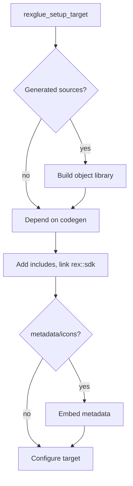

# CMake

A project builds with CMake. This page lists the CMake functions, cache variables, presets and options of the SDK. The examples use the project `foobar` from [Getting Started](../getting-started.md).

All functions come from the SDK package. They are available after `find_package(rexglue CONFIG REQUIRED)`, or after `add_subdirectory` of the SDK source. The project's `CMakeLists.txt` does one of the two (see [SDK Discovery](#sdk-discovery)).

A host executable is the native program that a project builds. It links the SDK and the recompiled code, and loads the [SDK modules](glossary.md#sdk-module) at runtime.

## Host Executable

### `rexglue_setup_target`

```
rexglue_setup_target(<target> [NO_COPY] [EXCLUDE <name>...])
```

Needs [`rexglue_project`](#rexglue_project) to have run first. Adds the generated sources of the entrypoint to the target, then calls `rexglue_configure_target` with the other arguments. The project's `CMakeLists.txt` calls it on the executable.



- The generated sources build into the object library `foobar_recompiled`, which the target links.
- The include paths are the project root, `src` and the entrypoint output folder.
- If a `metadata/icons` folder exists, it is embedded with the prefix `icons`.

### `rexglue_configure_target`

```
rexglue_configure_target(<target> [NO_COPY] [EXCLUDE <name>...])
```

Makes an executable a host executable. It applies the compile settings, links the host allocator, and after each build copies the runtime files next to the executable. The runtime files are the SDK libraries, SDK modules and third party libraries that the program loads, listed under [Runtime Files](#runtime-files).

| Argument | Meaning |
|---|---|
| `<target>` | The host executable target. |
| `NO_COPY` | Copies no runtime files. Cannot be combined with `EXCLUDE`. |
| `EXCLUDE` | Leaves the listed [runtime files](#runtime-files) out of the copy. A name is an SDK module or driver module target such as `rexhid-xinput`, a linked SDK library such as `rexbase`, or `SDL3`. |

- Defines `REXGLUE_BUILD_CONFIG` as the build configuration.
- On Linux and macOS, the run path is the executable folder and the install library folder.
- On Windows, exports the symbols that select the discrete GPU on hybrid graphics systems.
- Any other argument is a configure error.

#### Runtime Files

- `rexbase` (with ImGui), `rexppc`, `rexkernel`, `rexapp`, and `TracyClient` when that target exists.
- `rexfilesystem`, `rexhid`, `rexapu`, `rexui`, `rexgpu`, `rexxam` and `rexxbdm`.
- `rexgpu-xenos-null`, `rexgpu-xenos-vulkan`, `rexapu-sdl3`, `rexhid-sdl3` and `rexui-sdl3`, plus `rexgpu-xenos-d3d12` and `rexhid-xinput` on Windows.
- SDL3, under its soname on Linux and macOS, such as `libSDL3.so.0`.
- On macOS, the Vulkan loader and MoltenVK with its ICD file, in a `vulkan` folder.
- On Windows, the DLLs of the linked shared libraries and their PDB files.

### `rexglue_get_runtime_files`

```
rexglue_get_runtime_files(<host_target> <out_var>)
```

Sets `out_var` to the libraries, SDK modules and SDL3 that `rexglue_configure_target` copies, as absolute paths in the folder of the host executable. Call it after `rexglue_configure_target`.

- Leaves out the Windows runtime DLLs and PDBs, the macOS `vulkan` folder and libraries the host links on its own.
- Entries can be generator expressions, so use the list only where CMake accepts them, such as `install(FILES)` and `file(GENERATE)`.

```cmake
rexglue_configure_target(mygame)
rexglue_get_runtime_files(mygame mygame_runtime_files)
install(FILES ${mygame_runtime_files} TYPE BIN)
```

## DLL Modules

### `rexglue_configure_module_target`

```
rexglue_configure_module_target(<target> [HOST <host_target>])
```

Applies the compile settings and the host allocator to the shared library of a DLL module, and on Linux sets the run path. The `dll_targets.cmake` that codegen writes calls it for each DLL module.

| Argument | Meaning |
|---|---|
| `<target>` | The module library target. |
| `HOST` | The host target. The module builds into the folder of the host executable, and the host depends on the module. The host can be declared after the module. |

- Without `HOST`, the output goes to `CMAKE_RUNTIME_OUTPUT_DIRECTORY` when set.
- The module target copies no runtime files. The target of the host executable copies them.

## Build Steps

### `rexglue_add_codegen`

```
rexglue_add_codegen(<target> MANIFEST <file> OUTPUT_DIR <folder> WORKING_DIRECTORY <folder>
                    TOOL <command...> [MAX_FILE_SIZE <bytes>] [SOURCES <file>...])
```

Defines a custom target that runs `rexglue codegen`. `rexglue_project` calls it to create `foobar_codegen`.

- The target reruns when an input in its dependency file, `<target>.d` in the build folder, or `MAX_FILE_SIZE` changes.
- The target writes `sources.cmake`, a configure dependency, so a changed source list regenerates the build files.

| Argument | Meaning |
|---|---|
| `<target>` | The custom target. |
| `MANIFEST` | Points to the [project manifest](manifest.md). |
| `OUTPUT_DIR` | Points to the entrypoint output folder, which contains `codegen.build.stamp` and `sources.cmake`. |
| `WORKING_DIRECTORY` | Sets the folder the tool runs in. |
| `TOOL` | Gives the command that runs the tool, such as `$<TARGET_FILE:rex::rexglue>`. |
| `MAX_FILE_SIZE` | Passed as `--max_file_size_bytes`. |
| `SOURCES` | Lists the generated files as outputs of the step. |

### `rexglue_embed_metadata`

```
rexglue_embed_metadata(<target> DIRECTORY <folder> [PREFIX <prefix>])
```

Embeds the files under a folder into the executable. With `DIRECTORY metadata/icons` and `PREFIX icons`, the program can read the embedded file as `icons/foo.png` through `FindEmbeddedMetadataAsset` from `rex/ppc/image.h`.

| Argument | Meaning |
|---|---|
| `<target>` | The target that receives the files. |
| `DIRECTORY` | Required. Points to the folder to embed. |
| `PREFIX` | Adds a prefix to the asset paths. |

## Compile Settings

The configure functions and the generated `CMakeLists.txt` call these for the targets of the project. Call them yourself only for additional targets of your own.

### `rexglue_apply_target_settings`

```
rexglue_apply_target_settings(<target>)
```

Applies the CPU flags that the SDK and the generated code need:

- `-msse4.1` on x86_64
- `-mcmodel=large` and the `--no-relax` link option on Linux x86_64
- `-march=armv8-a` on Linux aarch64

`rexglue_cpu_flags(<out_var>)` returns the compile flags as a list.

### `rexglue_link_host_allocator`

```
rexglue_link_host_allocator(<target>)
```

Makes the `operator new` and `operator delete` of the target call the shared host allocator of the SDK, so that one binary can free memory that another binary allocated.

- Static libraries are skipped.
- `rexglue_configure_target` and `rexglue_configure_module_target` call it.

### `rexglue_set_rpath`

```
rexglue_set_rpath(<target> <origin>)
```

Sets the run path to the target's folder and the install library folder. `<origin>` is `$ORIGIN` on Linux and `@executable_path` on macOS.

### `rexglue_recomp_options`

```
rexglue_recomp_options(<options_var> <optimized_var>)
```

Computes the compiler options for the recompiled code for every configuration, each wrapped in `$<CONFIG:...>`.

| Argument | Meaning |
|---|---|
| `<options_var>` | Receives the options. |
| `<optimized_var>` | Receives `ON` when any configuration sets an optimization level. |

- It declares the [cache variables](#cache-variables).
- The options always include `-fasync-exceptions` on Windows and `-fasynchronous-unwind-tables` elsewhere.

## Project Functions

The `CMakeLists.txt` that `rexglue init` writes calls these functions. They are defined in `rexglue_project.cmake` of the SDK package. Call `rexglue_project` first. `rexglue_setup_target`, `rexglue_setup_host_library` and `rexglue_apply_recomp_settings` stop with an error that names the missing call when it has not run.

### `rexglue_project`

```
rexglue_project(<name> [OUTPUT_DIR <folder>])
```

Connects a project to codegen. `<name>` is the project name, and the manifest must be `<name>_manifest.toml`. `OUTPUT_DIR` is the codegen output folder, relative to the project. It must be the `out_directory_path` of `[entrypoint]` in the manifest. `rexglue init` writes `generated/<name of the XEX>`, so a project made by `init` passes that folder. The default `generated` fits only a manifest that uses that folder. The project's `CMakeLists.txt` calls it after it finds the SDK.

- Sets `REXGLUE_HOST_TARGET` to `PROJECT_NAME` unless the project set it before the call. It selects the executable that DLL modules build next to.
- Declares the `REXGLUE_RECOMP_MAX_FILE_SIZE` cache variable and stops when it is not a byte count.
- Calls `rexglue_recomp_options`, which sets `REXGLUE_RECOMP_OPTIONS` and `REXGLUE_RECOMP_OPTIMIZED`.
- Includes `sources.cmake` from the output folder when codegen has written it. It then sets `REXGLUE_ENTRYPOINT_GENERATED_SOURCES`, `REXGLUE_ENTRYPOINT_PREFIX` and `REXGLUE_ENTRYPOINT_INCLUDE_DIR`, and puts the compiler options for the recompiled code on the generated sources.
- Calls `rexglue_add_codegen` for `foobar_codegen`.
- Includes `dll_targets.cmake` when codegen has written it.

`rexglue_project`, `rexglue_setup_host_library` and `rexglue_setup_target` are macros, so the variables above and the ones `sources.cmake` and `dll_targets.cmake` set stay visible to the project's `CMakeLists.txt`. `rexglue_apply_recomp_settings` is a function.

### `rexglue_setup_host_library`

```
rexglue_setup_host_library(<library>)
```

Applies the SDK settings, the include paths and the codegen dependency to a library that compiles against the SDK, and links it to `rex::sdk`. The project's `CMakeLists.txt` calls it on `foobar_common`, the library that the generated `CMakeLists.txt` builds from your sources in `src`.

`rex::sdk` is the one target a project links. It collects `rex::base`, `rex::ppc`, `rex::xenos`, `rex::kernel`, `rex::xam`, `rex::xbdm` and `rex::app`.

### `rexglue_apply_recomp_settings`

```
rexglue_apply_recomp_settings(<target> <pch_header>)
```

Applies the precompiled header and the compiler options for the recompiled code to a target.

### SDK Discovery

The project's `CMakeLists.txt` finds the SDK in one of two ways:

- When the cache variable `REXSDK_DIR` points to an SDK source folder, such as a submodule, it adds that folder with `add_subdirectory` and builds the SDK with the project.
- Otherwise it finds an installed SDK with `find_package(rexglue)`. CMake searches `CMAKE_PREFIX_PATH` first and then the user package registry, which every install fills.

`rexglue init` writes no paths from your machine into the presets and never writes to the registry. For an SDK source tree inside the project, it sets `REXSDK_DIR` to `${sourceDir}/<folder>`. Otherwise it prints how to point CMake at the SDK.

The number in `find_package(rexglue <version> REQUIRED CONFIG)` is the SDK version that wrote the project. CMake accepts that version or a newer one with the same major version. To ask for another version, edit the number. To pick one install when several are present, set `rexglue_DIR` to its `lib/cmake/rexglue` folder or `CMAKE_PREFIX_PATH` to its prefix. When CMake finds no package, it reports `Could not find a package configuration file provided by "rexglue"`.

### Updating a Project

A project made with an earlier SDK includes `generated/rexglue.cmake`. The SDK no longer writes or updates the file. Remove it once:

1. Delete `generated/rexglue.cmake`. Nothing else under the output folder needs to be committed. Delete `generated/<name of the XEX>/codegen.d` too. An earlier SDK wrote it with absolute paths, and the dependency file now lives in the build folder.
2. In `CMakeLists.txt`, replace the line `include(generated/rexglue.cmake)` with the lines below, for a project named `foobar` whose entrypoint is `default.xex`:

```cmake
if (REXSDK_DIR)
  add_subdirectory("${REXSDK_DIR}" rexglue-sdk)
else ()
  find_package(rexglue 0.12.0 REQUIRED CONFIG)
endif ()
rexglue_project(foobar OUTPUT_DIR generated/default)
```

The `REXSDK_DIR` branch builds the SDK from a source folder. Leave it out when the project only uses an installed SDK. `OUTPUT_DIR` is the `out_directory_path` of `[entrypoint]` in the manifest, `generated/<name of the XEX>` for a project made by `init`.

A project that is not edited stops at configure with an error that gives the two edits above, with the project's name and output folder filled in. A leftover `generated/rexglue.cmake` that `CMakeLists.txt` no longer includes does nothing.

### Build Record

An installed SDK records what it was built with. `rexglueConfig.cmake` sets these variables:

| Variable | Meaning |
|---|---|
| `REXGLUE_CXX_COMPILER_ID` | `CMAKE_CXX_COMPILER_ID` of the SDK build, such as `Clang`. |
| `REXGLUE_CXX_COMPILER_VERSION` | `CMAKE_CXX_COMPILER_VERSION` of the SDK build. |
| `REXGLUE_STDLIB` | Linux only: `libstdc++`, `libc++` or `unknown`. |
| `REXGLUE_LIBSTDCXX_RELEASE` | Linux only: the major release of libstdc++ (`_GLIBCXX_RELEASE`), empty for another library. |

On Linux, `find_package(rexglue)` and `rexglue_configure_target` compare `REXGLUE_STDLIB` and `REXGLUE_LIBSTDCXX_RELEASE` with the standard library of the project's C++ compiler. A mismatch stops the configure with an error that names both libraries and the fix. Only the major release is compared, and no setting turns the check off. With Clang, when the GCC install of the release the package was built against exists in `/usr/lib/gcc/<processor>-linux-gnu/<release>`, `find_package(rexglue)` adds `--gcc-install-dir=<that folder>` to `CMAKE_C_FLAGS` and `CMAKE_CXX_FLAGS` and checks again, so the project needs no flag. The flags are set where `find_package(rexglue)` runs, so call it at the top level of the project's `CMakeLists.txt`, not inside a function or a subdirectory. The error remains when the folder is missing or the second check still differs.

## Cache Variables

These cache variables apply to the recompiled sources only, not to your own code.

| Variable | Meaning |
|---|---|
| `REXGLUE_RECOMP_OPTIMIZATION` | Sets the optimization level to empty, `O0`, `O1`, `O2` or `O3`. Empty uses the default of the configuration, see [Defaults](#defaults). |
| `REXGLUE_RECOMP_DEBUG_INFO` | Sets the debug info level to empty, `line-tables-only`, `full` or `none`. Empty uses the default of the configuration, see [Defaults](#defaults). |
| `REXGLUE_RECOMP_MAX_FILE_SIZE` | Sets the largest generated source file in bytes. Empty uses the tool default. See [Limits](cli.md#limits). |

### Defaults

| Configuration | Optimization | Debug info |
|---|---|---|
| Debug | `O1` | `line-tables-only` |
| Release | Uses the CMake build type flags | `none` |
| RelWithDebInfo | Uses the CMake build type flags | `line-tables-only` |

## Presets

`CMakePresets.json` in the SDK root defines these configure presets. Each one builds into `out/build` and installs into `out/install`, in a folder named after the preset, such as `out/install/linux-amd64`. A preset is available only on its host system. The project presets that `rexglue init` writes have the same names, except `linux-amd64-tsan`.

| Configure preset | Host | Build presets |
|---|---|---|
| `win-amd64` | Windows | `win-amd64-debug`, `win-amd64-release`, `win-amd64-relwithdebinfo` |
| `win-arm64` | Windows | `win-arm64-debug`, `win-arm64-release`, `win-arm64-relwithdebinfo` |
| `linux-amd64` | Linux | `linux-amd64-debug`, `linux-amd64-release`, `linux-amd64-relwithdebinfo` |
| `linux-amd64-tsan` | Linux | `linux-amd64-tsan` (Debug only) |
| `linux-arm64` | Linux | `linux-arm64-debug`, `linux-arm64-release`, `linux-arm64-relwithdebinfo` |
| `mac-amd64` | macOS | `mac-amd64-debug`, `mac-amd64-release`, `mac-amd64-relwithdebinfo` |
| `mac-arm64` | macOS | `mac-arm64-debug`, `mac-arm64-release`, `mac-arm64-relwithdebinfo` |

- `linux-amd64-tsan` is `linux-amd64` with `REXGLUE_ENABLE_TSAN` on.
- Each build preset has a test preset with the same name.

## SDK Build Options

| Option | Default | Meaning |
|---|---|---|
| `REXGLUE_BUILD_TESTS` | `ON` when the SDK is the top level project | Adds the unit tests. The default target and `install` do not build them. Build the `rextest_check_all` target to build and run them, or `rextest_benchmark_all` to run the benchmarks. |
| `REXGLUE_BUILD_PPC_TESTS` | `OFF` | Builds the PPC instruction tests, which require the PPC toolchain. |
| `REXGLUE_ENABLE_SANITIZERS` | `OFF` | Builds with UndefinedBehaviorSanitizer. |
| `REXGLUE_ENABLE_TSAN` | `OFF` | Builds with ThreadSanitizer and adds a `-tsan` suffix to the output folder. |
| `REXGLUE_ENABLE_TRACY` | `ON` | Links Tracy and defines `REXGLUE_ENABLE_PROFILING` in every configuration except Release. |
| `REX_PHYSICAL_OFFSET_IN_CODE` | Linux on aarch64: `ON` when the build host page size is above 4 KiB, else `OFF` | Makes generated code add `0x1000` to every guest address at or above `0xE0000000`, which hosts with memory pages larger than 4 KiB need. Only Linux on aarch64 reads the option. macOS on arm64 always adds the offset, and every other host handles it in the memory mapping instead. See [Address Translation](../runtime/memory.md#address-translation). |
| `REXGLUE_ENABLE_PERF_COUNTERS` | `ON` | Builds the perf counter registry and overlay in every configuration except Release. |
| `REXGLUE_GCC_INSTALL_DIR` | empty | Linux only. Adds `--gcc-install-dir=<dir>` to `CMAKE_C_FLAGS` and `CMAKE_CXX_FLAGS` before `project()`, so Clang compiles and links against that GCC install and its libstdc++, such as `/usr/lib/gcc/x86_64-linux-gnu/13`. The release CI sets it to GCC 13. Subprojects and the link line get the flag too. |
| `REXGLUE_VERIFY_HEADERS` | `OFF` | Creates the targets that compile each public header alone. clang-tidy checks the public headers only through these targets. |
