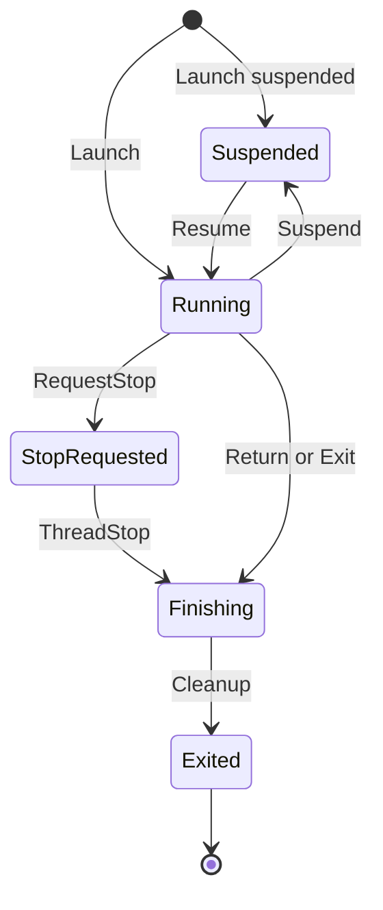

# Kernel Services

On the Xbox 360, the kernel manages the threads, synchronization objects, files and memory of the game, and the game reaches it by calling functions that the kernel exports. In ReXGlue each of these functions is a kernel export, a host function in `rexkernel` or `rexxam`. The kernel services are the host objects behind the exports. They hold the state that the exports share, such as the table of open handles and the list of guest threads.

`TitleRuntime::Load` creates the kernel services, and they stay valid until `TitleRuntime::Unload`. See [Runtime Lifecycle](lifecycle.md) for both calls, and `TitleRuntime` in the API reference for the call that returns each service.

## Reaching the Runtime

Export bodies and hooks find the runtime in one of two ways:

- `kernel::GetCurrent` returns the runtime that the calling thread belongs to. It works on guest threads and on the host worker threads of the runtime, and aborts on any other thread.
- `REX_RUNTIME()`, the same as `kernel::GetProcessRuntime`, works on any thread. It returns null before `TitleRuntime::Load` has created the services and once `Unload` has stopped the guest threads.

## Kernel Objects and Handles

A kernel object is a host object that stands for a console kernel object, such as an event, a thread or an open file. The game refers to an object by a handle, a `u32` that the object table assigns. `IObjectTable`, from `TitleRuntime::GetObjectTable`, holds every object and its handles.

### Handles

- A handle is `0xF8000000` (`kHandleBase`) plus four times the slot of the object in the table.
- The pseudo handle `0xFFFFFFFF` stands for the current process and translates to 0. `0xFFFFFFFE` translates to the handle of the calling thread.
- `Add` creates the first handle of an object. `Duplicate`, `Open` and `OpenByName` each create another handle with its own value, and `Close` frees one handle.
- `OpenByName` opens an object by a name that `AddName` registered, ignoring case.
- `Reference` and `Dereference` count pointer references, which keep an object alive after its last handle is closed.
- The table destroys an object when it has no handle, no pointer reference and no pin.

```cpp
auto added = kernel::GetCurrent().GetObjectTable().Emplace<kernel::EventObject>(
    kernel::AddOptions{}, true, false);
if (added) {
  X_HANDLE handle = *added;
}
```

The example creates a manual reset event that starts not signaled, and returns its first handle.

Host code that uses an object for the length of a call pins it. `IObjectTable::Get` returns a pin, an `ObjectPin` or a typed `Pinned<T>`, that keeps the object alive until the pin is destroyed, even if the game closes the last handle in the meantime. An invalid handle, or an object of a type other than `T`, gives an empty pin.

### Resolving a Guest Address

Every console synchronization object starts with an `X_DISPATCH_HEADER`, a small block in guest memory that holds its type and signal state. A game can embed such an object in its own structures and pass its guest address where a handle is expected. `IObjectTable::ResolveObject` takes the address and returns a pin on the kernel object for it. For an event, a mutant (the kernel name for a mutex), a semaphore or a timer, the first call creates that object. An object created this way has no handle. A `KeInitialize*` call over the body of an object that `NtCreate*` made resets that same object, and threads waiting on it stay blocked.

### Object Types

| `ObjectType` | Contents |
|---|---|
| `kEvent`, `kSemaphore`, `kMutant`, `kTimer` | The host primitive of the same name from `rex::platform`. |
| `kFile` | A `filesystem::IFile`. |
| `kNotifyListener` | A host event. |
| `kIOCompletion` | A host semaphore. |
| `kSymbolicLink`, `kModule` | No host primitive. |
| `kThread` | A `ThreadRef`, which refers to a `KernelThread` in the thread registry. |
| `kXAM` | An `IXAMObject` from `object/xam_object.h`, such as an enumerator. |

The console keeps a guest block for each object, an `X_OBJECT_HEADER` followed by the object body. `AllocObjectBlock` allocates this block from the kernel pool, from a workspace, or from the system heap for an object type that the console has no type for. A pool block counts against the [title budget](memory.md#title-budget) by the pool rule. XAM enumerator objects take their blocks from the [title workspace](#title-workspace). `NtCreateEvent`, `NtCreateSemaphore`, `NtCreateMutant` and `NtCreateTimer` allocate this block, so `ObReferenceObjectByHandle` returns the body address for their handles. The body of every synchronization object, an object whose guest block starts with an `X_DISPATCH_HEADER`, starts with an empty wait list, as the console writes it.

## Threads

Each guest thread is a host thread. A `KernelThread`, from `rex/kernel/object/kernel_thread.h`, holds the host thread, the guest register state, the guest `X_KTHREAD` block, the guest stack and a PCR, the processor control region that guest code reads through register r13. A `KernelThread` built with a host function instead of a guest entry point is a host worker of the runtime, such as `Kernel Dispatch`.

`IThreadRegistry`, from `TitleRuntime::GetThreadRegistry`, holds every `KernelThread`:

- `Launch` takes ownership of a `KernelThread`, starts it and returns its handle.
- `Find`, `FindByHandle` and `All` return `ThreadPin` values that keep a thread alive while you hold them.
- `RegisterFiber` and `FindFiber` track the host fibers that run the guest fiber routines.
- `RegisterThreadNotify` registers the address of an `XTHREAD_NOTIFICATION` block of the game, whose routine runs when a thread starts or ends.

See [Thread List](../appendix/thread-list.md) for every thread of the process.

### Stopping a Thread

A guest thread cannot be killed from outside, because it may hold locks or be inside host code. The runtime asks it to stop and waits:

1. `RequestStop` marks the thread. The thread stops at its next call to `CheckStop` or its next alertable wait, a wait that the kernel can interrupt to deliver an asynchronous procedure call. Both throw `ThreadStop` to unwind the thread.
2. If the thread has not stopped after `runtime.terminate_timeout_ms`, 2000 ms by default, the runtime logs a warning and calls `ForceStop` every 5 ms. `ForceStop` makes a thread that is inside recompiled code throw `ThreadStop` immediately. The warning repeats each time the timeout passes again.

Teardown also waits until every host thread of a `KernelThread` has left its entry function, before it resets the object table, the thread registry and the guest memory. A thread that already left the registry still deletes its `KernelThread` and frees its guest blocks on its own host thread, so waiting for the registry entries alone is not enough.

A guest thread moves between these states:



When a guest thread finishes, `KernelThread::Finish` runs the thread notification routines, unless the whole game is ending.

`ITitleExit`, from `TitleRuntime::GetTitleExit`, ends the whole game.

- `TerminateTitle` runs the terminate notifications of the game, then stops and waits for every guest thread.
- `ExitTitle` first reports a `TitleExitReason`, then terminates the game. See [Title Exit](../app/app-lifecycle.md#title-exit).

## Process Model

The console kernel runs three processes, each kept in an `X_KPROCESS` block in guest memory. `KernelGuestGlobals` from `rex/kernel/types/thread.h` holds the three blocks and other kernel data.

| Process | Type | Differs from the other processes |
|---|---|---|
| Idle | `kXProcTypeIdle` (0) | A `quantum` of `0x7F`, the thread time slice. |
| Game | `kXProcTypeUser` (1) | The TLS layout and the default stack size, which come from the executable headers. |
| System | `kXProcTypeSystem` (2) | 32 TLS slots. |

In the `tls_slot_bitmap` of each process, a set bit marks a free TLS slot.

## Overlapped Completion and DPCs {#dispatcher}

Two services handle work that the console finishes after the call that starts it.

An overlapped operation is a file or XAM call that returns before its work is done. The game passes an `XOVERLAPPED` block in guest memory, and the kernel later writes the result, the extended error and the length into the block and signals the event in it. `IOverlappedDispatcher` completes these operations:

- `Complete` writes the completion on the calling thread.
- `CompleteDeferred` marks the operation pending and returns. The `Kernel Dispatch` thread then runs the `pre` callback, waits 100 ms, runs the work, writes the completion and runs the `post` callback.
- `Publish` runs the two writes that complete a block, the result first and then the event. `Observe` runs the reads of a block, and a result that it sees as complete has its event set, so a reader never sees one write without the other.
- `CompletionOptions` holds the `result`, an `X_RESULT`, and the optional `extended_error` and `length`. The extended error defaults to the result. The length defaults to 0 on success and `0xFFFFFFFF` on failure.

A DPC, a deferred procedure call, is a routine that the kernel queues to run later at dispatch IRQL, the interrupt priority level at which the console does not switch threads. Timers and interrupt handlers queue DPCs. `IDPCQueue` manages the queue:

- `Queue` adds a DPC of the game unless it is queued, and returns whether it added it.
- `Remove` removes a queued DPC and returns whether it was queued.
- `Drain` runs the queued DPCs one at a time at dispatch IRQL. It does nothing inside an interrupt or a DPC, on a thread without guest thread state, or while another thread drains.

## Guest Audio

The audio part of `rexkernel` is the guest side of audio. The game calls it through the XAudio kernel exports. It does not play sound. It passes the frames of the game to the audio system of the app, which plays them through its driver.

- `XAudioRegisterRenderDriverClient` registers a render client, a guest callback that produces audio frames. The runtime has eight client slots, and each client gets a stream in the audio system.
- The `Audio Worker` thread calls the callback of a client each time the audio system needs another frame, and `XAudioSubmitRenderDriverFrame` hands the frame to the stream.
- The `XMA Decoder` thread decodes XMA, the compressed audio format of the console, for the contexts that the game sets up through the APU register block. See [MMIO Blocks](memory.md#mmio-blocks).
- `TitleRuntime::SetAudioPaused` pauses the worker and the decoder, and resumes them.

`TitleRuntime::Launch` starts guest audio, and the game runs without audio when it fails to start. With no audio system in the app, every client registration fails.

## Downloadable Content

Host code, such as a menu in your program, can enable or disable each downloadable content package through `IContentManager`, from `TitleRuntime::GetContentManager`. Each package can be enabled or disabled for one profile or for all profiles.

- A profile flag overrides the all profiles flag, and a package with neither is enabled.
- A disabled package is absent from `ListContent`, `HasContent` and `OpenContent` the next time the game lists or opens content.
- The flags are saved in `content_state.toml` under `app.user_root`.

## Title Workspace

The title workspace is a range of title memory that XAM uses on behalf of the game, for example for enumerator buffers. `XamAlloc` uses it when the game asks for workspace memory, and `XamFree` returns memory to it. `ITitleWorkspace` allocates from it. The accessor that returns it is named `TitleRuntime::GetGuestWorkspace`.

- The size comes from the `kXEXHeaderTitleWorkspaceSize` header of the executable. Without the header the workspace has a default size.
- `ITitleWorkspace::Allocate` zeroes the block when the caller asks for it, and returns an error when the workspace is full.
- A block is sized to the request, rounded up to 16 bytes. The workspace takes the smallest free range that fits, so a freed block can be taken again by a request of the same size.
- `ITitleWorkspace::Free` ignores an address outside the workspace, or one that is not a live block, with a log message.
- `XamAlloc` returns `0` on success, `E_INVALIDARG` for a null out pointer, `E_UNEXPECTED` for flags that select no heap, or `E_OUTOFMEMORY` when the heap is full. `XamAllocEx` takes the same path, or allocates physical memory when flags bit `0x40000000` is set.

## Kernel Exports

A kernel export is a host function that takes the place of a function that the game imports from the console's kernel, XAM or XBDM. The game reaches it through its import table. See [Export Macros](../codegen/hooks.md#export-macros) for the macros that define exports.

### Export Tables

`rex/kernel/export.h` declares the export tables of `xboxkrnl`, `xam` and `xbdm` and the calls that search them.

- `ExportEntry` holds the ordinal, the type (`kFunction` or `kVariable`), the name and the host function.
- Each table must be sorted by ordinal, with no ordinal twice. A table that breaks this rule fails to compile.
- `ModuleFromName` accepts the short name (`xam`) or the long name (`xam.xex`).
- `FindByOrdinal` returns the entry of an ordinal.
- `IsNoReturnExport` returns true for the exports that end the calling thread or restart the console.

### XAM Export Forwarding

The XAM exports live in two libraries. `rexkernel` holds the `__imp__` symbols that the generated code calls, and the stub bodies. `rexxam` holds the implemented bodies of the XAM exports, and the bodies of the shims that are implemented in `rexxam`, such as the `file` shims.

- Each XAM `__imp__` symbol in `rexkernel`, and each `rexshim_` function that has its body in `rexxam`, forwards to the `rexxam` body of the same name.
- `rexkernel` binds the forwarders in its `Init`, and only when `rexxam` is loaded and serves its bodies. `Init` fails and reports the export when a forwarder has no body, a body has no forwarder, or two bodies have the same name.
- A call to a forwarder that has no bound body logs an error and leaves `r3` unchanged. That happens when `rexxam` is not loaded.

### XBDM Export Forwarding

The XBDM exports follow the same split. `rexkernel` holds the `__imp__` symbols and `rexxbdm` holds the bodies, which log that the export was called and return a fixed value where the export has one.

- The `Init` of `rexkernel` binds the forwarders when `rexxbdm` is loaded and fails and reports the export on a mismatch, as for XAM.
- A forwarder with no bound body does what the body does. It logs and sets `r3` to the same value.

A hook on an XAM `__imp__` symbol in your program replaces the forwarder.

## Shims

A shim is an SDK function that replaces one of the game's own library routines, such as `memcpy`, `CreateFileA` or `RtlAllocateHeap`. See [Shims](shims.md) for how to enable one.
