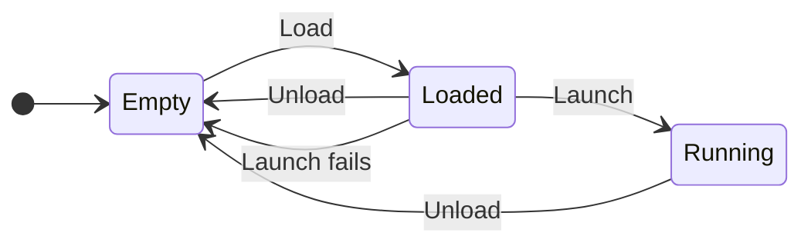
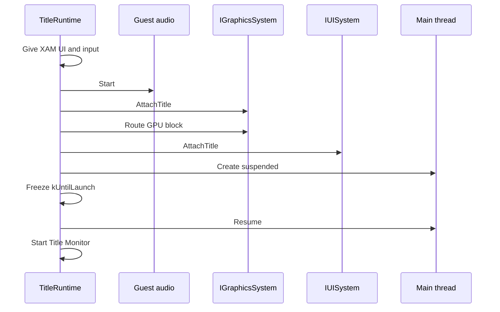
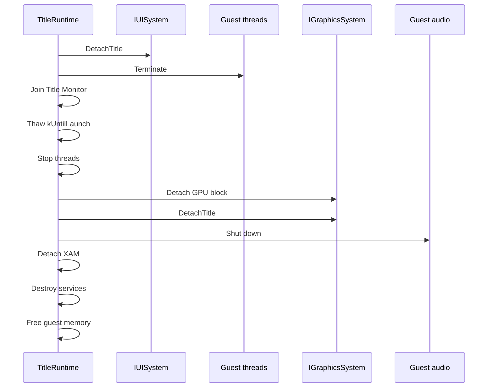

# Runtime Lifecycle

`rex::kernel::TitleRuntime`, declared in `rex/kernel/title_runtime.h`, is the object that runs a title. It maps guest memory, creates the kernel services, loads the XEX, connects the title to the systems of the app and starts its main thread. It has three calls: `Load`, `Launch` and `Unload`.

A `TitleRuntime` is constructed from the `PPCImage` that codegen writes for the project, the description of the recompiled code. Only one `TitleRuntime` can be loaded at a time. `TitleApp::LaunchTitle` calls `Load` and `Launch`, and `TitleApp::UnloadTitle` calls `Unload`. A tool that only inspects a title calls `Load` and never `Launch`.

```cpp
rex::Result<void> RunTitle(const rex::ppc::PPCImage& image) {
  rex::kernel::TitleRuntime title(image);
  REX_TRY_VOID(title.Load());
  REX_TRY_VOID(title.Launch());
  title.Unload();
  return rex::Ok();
}
```

A failed `Load` leaves the runtime empty. After `Unload`, the same object can load again:



## Load

`Load` prepares the title without running any of its code. An image with no recompiled code runs in tool mode, which tools such as `rexglue` use to read a XEX. Tool mode skips step 2.

1. `Load` maps guest memory within the `runtime.title_memory_mb` budget and creates the kernel services. It creates the kernel modules `xboxkrnl.exe`, `xam.xex` and `xbdm.xex`, the host objects that stand for the system libraries a XEX imports from. It then mounts `title.game_root` as `game:`. If `title.game_root` is empty, `Load` logs a warning and skips the mounts.
2. `Load` fills the [function table](../codegen/generated-code.md#function-table), which maps each guest function address to its recompiled function.
3. `Load` registers the DLL modules of the image. For each DLL module of the project, the generated `register_modules` function passes its PE name, its guest path and its host library to `IModuleRegistry::RegisterRecompiledModule`. An empty host library name means that the code is linked into the executable.
4. `Load` adds each file in `title.imports` as an import candidate, a file that the module registry tries when the XEX imports a library that it finds nowhere else. It then loads the executable that `title.entry` names, `game:\default.xex` by default.
5. If the image uses the shim heap, `Load` creates it with the size from `runtime.heap_size_mb`. See [Shims](shims.md#shim-heap).

Loading the executable in step 4 maps its data sections and resolves its imports. Code and read only data sections stay read only unless `runtime.writable_code_segments` is set. The step reads the stack size, the TLS layout and the title workspace size from the executable headers, writes the kernel variables `ExLoadedImageName` and `ExLoadedCommandLine`, starts the `Kernel Dispatch` thread and loads the achievements of the title.

`title.imports` separates its entries with `|`. An empty `title.entry` loads no executable.

A failed `Load` unmaps everything. `Load` fails in these cases:

- Another runtime is loaded, the `rexkernel` module is not running or the `rexxam` module is not loaded.
- Guest memory cannot be mapped, or the function table cannot be filled.
- The executable is missing, with the message "Entrypoint XEX game:\default.xex was not found".
- The executable fails to load, or the shim heap cannot be created.

### Module Loading

Loading an image binds its imports from `xboxkrnl`, `xam` and `xbdm` to the kernel exports. An import from another library is bound at its first call, to the export of the loaded module with that name.

- A variable import with no export behind it gets a marker value, and the load logs a warning.
- A call through an import that no export table and no registered library implements stops the process with "Unresolved import of ordinal" and the library name.

At runtime, the title loads more modules with `XexLoadImage`. The export calls `IModuleRegistry::LoadUserModule`, which loads a XEX or ELF image and binds the recompiled library that `register_modules` registered for it.

## Launch

`Launch` connects the loaded title to the systems of the app and starts it. It takes no arguments, because `App::Init` handed the system interfaces to the kernel module at startup. `Launch` needs the UI system and the settings of the app. Graphics, input and audio are optional, and the title runs without the ones that are missing.



1. `Launch` gives XAM the UI and input systems and the language of the title.
2. It starts guest audio: the render client slots that the XAudio exports use, the `Audio Worker` thread that calls the audio callbacks of the title, and the XMA decoder. A failure here logs a warning and the title runs without audio.
3. It attaches the title to the graphics system with the [driver context](../devices/driver-context.md) and routes the GPU register block to it.
4. It attaches the title to the UI system with the title information.
5. It creates `Main XThread` at the entry point of the executable, suspended.
6. It freezes the `kUntilLaunch` settings, then resumes the thread.
7. It starts `Title Monitor`, which reports a normal exit when the main thread returns.

If an attach or the thread creation fails, `Launch` unloads the title and returns the error.

## Unload

`Unload` reverses `Launch`, then frees guest memory:



- `Unload` waits for every guest thread to stop. See [Stopping a Thread](kernel.md#stopping-a-thread).
- After a launch, `Unload` must run on the UI thread.
- `Unload` does nothing when no title is loaded, and the destructor of `TitleRuntime` calls it.

## Settings and Services

See `TitleRuntime` in the API reference for every call.

- The service calls such as `GetObjectTable` and `GetFileSystem`, and `FindFunction`, work from `Load` on, without a launch, and stay valid until `Unload`.
- `REX_RUNTIME()` returns the loaded runtime from any thread. It returns the runtime once the first step of `Load` has created the kernel services, and null again once `Unload` has stopped the guest threads.
- `GetTitlePaths`, `GetRuntimeSettings` and `GetKernelSettings` return the settings classes of the `title`, `runtime` and `kernel` scopes.
